<p align="center">
  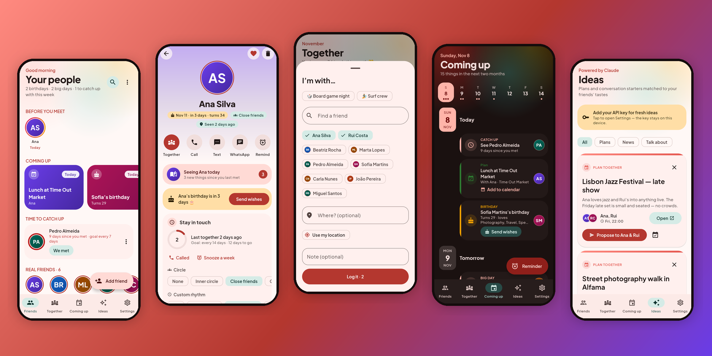
</p>

<h1 align="center">Good Company</h1>

<p align="center">
  <b>A little CRM for friendship.</b><br>
  Remember what your friends love, their kids' birthdays and the last time you saw each other —<br>
  and get a gentle nudge before it's been too long.
</p>

<p align="center">
  <a href="https://github.com/neteinstein/Good-Company/actions/workflows/ci.yml"></a>
  
  
  
</p>

---

## ✨ What it does

<table>
  <tr>
    <td width="33%">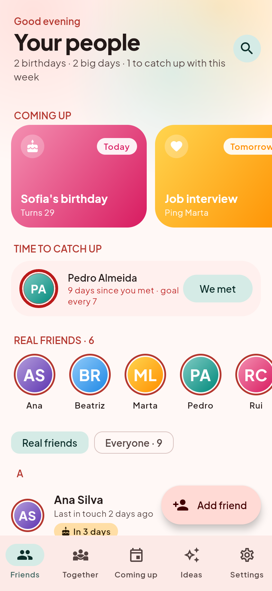</td>
    <td>
      <h3>Your people, at a glance</h3>
      <ul>
        <li>A greeting that tells you what matters this week — <i>“2 birthdays · 1 big day · 1 to catch up with”</i>.</li>
        <li><b>Coming up</b>: swipeable cards for birthdays (theirs <i>and their kids'</i>), big days and reminders.</li>
        <li><b>Time to catch up</b>: friends past their rhythm, with one-tap <i>We met</i>, <i>Called them</i> or a snooze (“remind me Saturday”).</li>
        <li><b>Drifting apart</b>: real friends whose <b>warmth score</b> is fading — sort everyone by “needs attention first”.</li>
        <li><b>Real friends in circles</b>: Inner (weekly), Close (monthly) or Good friends (quarterly) — every circle has its own default rhythm.</li>
        <li>Pull in your address book — or import a <b>.vcf</b> file from Google Contacts / iCloud (handy on the web).</li>
        <li>Search by name <i>or taste</i> — “jazz”, “F1”, “sushi”.</li>
        <li><b>Pick from contacts</b> without giving the app your whole address book.</li>
        <li>A <b>“Who’s next” widget</b> on your Android home screen.</li>
      </ul>
    </td>
  </tr>
  <tr>
    <td>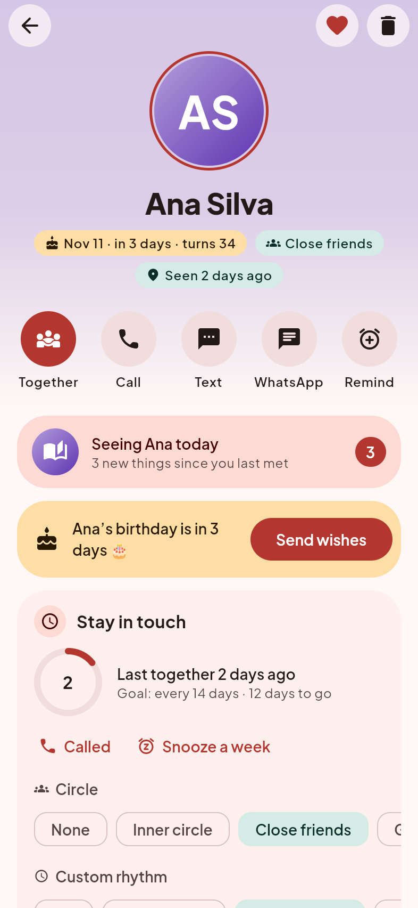</td>
    <td>
      <h3>Everything about a friend</h3>
      <ul>
        <li>A page tinted in their own colours, with one-tap <b>Together now</b> (with a little heart burst 💛), <b>Call</b>, <b>Text</b>, <b>WhatsApp</b> and <b>Remind me</b>.</li>
        <li><b>Stay in touch</b>: days since you last met against their circle's rhythm (or a custom one), a warmth score, snooze and “Called”.</li>
        <li><b>Birthday wishes</b>: a banner when it's their day, with a ready message for WhatsApp, text or share — personalised by AI if you like.</li>
        <li><b>Gifts</b>: jot ideas (for them or their kids), get AI suggestions, mark what you gave and for which occasion — never repeat a present.</li>
        <li><b>Loves / not a fan of</b>, <b>kids</b> (names, birthdays, what each one likes — perfect before a party), <b>important moments</b> (“knee surgery on Friday”) and notes.</li>
        <li><b>Things to talk about</b>: AI-matched news and conversation starters from their tastes and recent chats.</li>
        <li><b>Plans</b>: pick a day and it reminds you — then asks <i>“Did you meet?”</i> so only real meetups count. Add any plan to your calendar.</li>
        <li><b>Good company for</b> a weekday lunch, a hike, drinks… and <b>talking points from your own notes</b>, no AI key needed.</li>
        <li><b>Pause</b> catch-ups for someone (history kept), or let calls and chats count for friends who live far away.</li>
        <li>Import a WhatsApp chat export to keep last-contact dates and context.</li>
      </ul>
    </td>
  </tr>
  <tr>
    <td>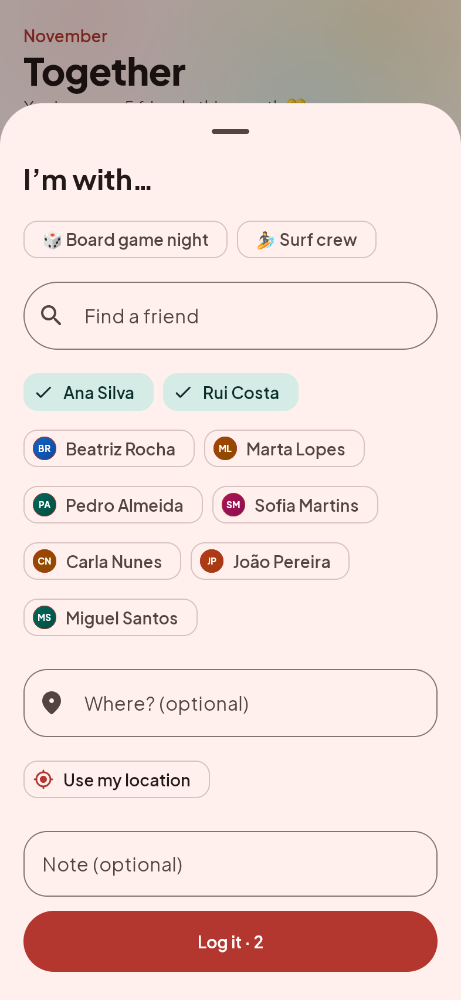</td>
    <td>
      <h3>One tap: “I'm with…”</h3>
      <ul>
        <li>Pick who you're with — or a whole saved group — optionally where (typed, or your location) and a note. Done.</li>
        <li><b>Saved groups</b> (“Board game night”, “Surf crew”) with their own rhythm: get a nudge when you haven't all been together in a while.</li>
        <li>See <b>the last time you were with any group</b> — “Ana & Rui: last together 2 days ago at Hot Clube, 3× in total”.</li>
        <li>A monthly view of meetups, friends seen and your favourite spot.</li>
        <li><b>Who’s free for…?</b> Pick an occasion and see who’d be great company — those you haven’t seen in a while first — then plan it.</li>
      </ul>
    </td>
  </tr>
  <tr>
    <td>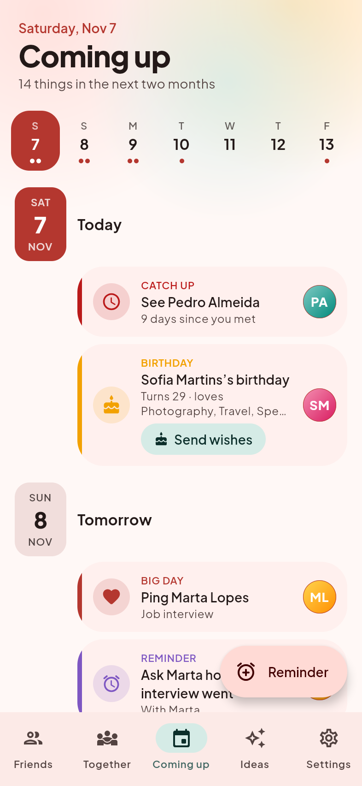</td>
    <td>
      <h3>Never miss what matters</h3>
      <ul>
        <li>A week strip and timeline of birthdays, kids' birthdays, big days, overdue catch-ups and your reminders.</li>
        <li>Reminders like <i>“Book tickets for the jazz festival with Ana & Rui”</i>, with undo on delete.</li>
        <li>Local notifications on Android and iOS at the hour you choose — nothing scheduled on a server. Catch-up nudges have quick actions: <i>We met</i>, <i>Called</i>, <i>Next week</i>.</li>
        <li><b>Calm by default</b>: one weekly note with who to catch up with (or at most one nudge a day), and nudges get quieter if you’re not opening the app.</li>
        <li><i>Send wishes</i> right from a birthday in the agenda.</li>
      </ul>
    </td>
  </tr>
  <tr>
    <td>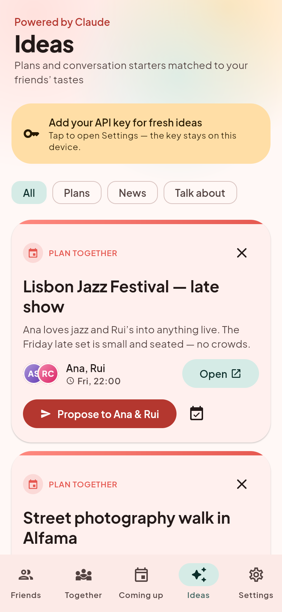</td>
    <td>
      <h3>Ideas, powered by Claude</h3>
      <ul>
        <li><b>Weekly plans</b>: once a week, real events near you that match the tastes of friends you opt in — grouped by who'd enjoy them together.</li>
        <li><b>Turn an idea into a plan</b>: “Propose to Ana & Rui” drafts the invite and opens WhatsApp, a text or the share sheet — or save it as a dated plan.</li>
        <li><b>News & talking points</b> per friend, grounded with web search and linked to the source.</li>
        <li>Bring your own Anthropic API key — stored only on your device.</li>
      </ul>
    </td>
  </tr>
  <tr>
    <td>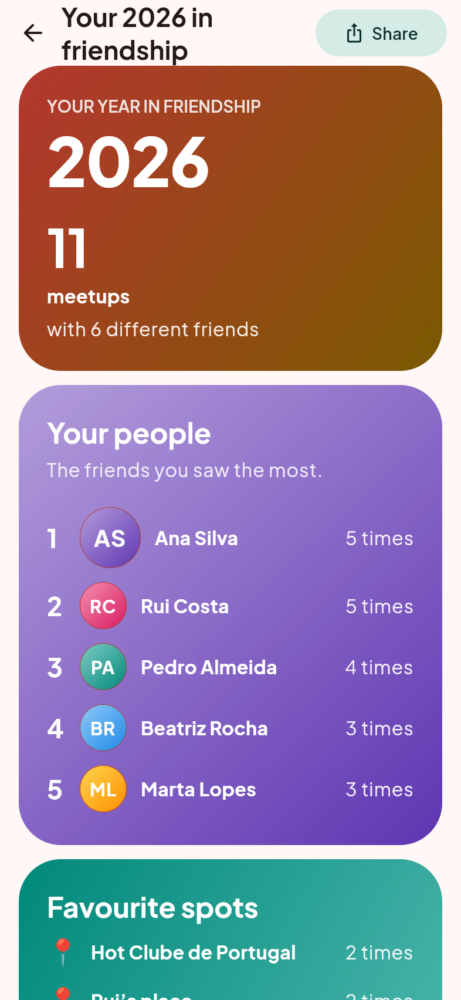</td>
    <td>
      <h3>Your year in friendship</h3>
      <ul>
        <li>A Wrapped-style look back: meetups, who you saw most, favourite spots, busiest month, longest weekly streak, biggest get-together and new faces.</li>
        <li>Built only from what's on your device — and shareable as text in one tap.</li>
      </ul>
    </td>
  </tr>
</table>

### 🌍 In your language

English, **Português**, **Español**, **Français** and **Română** — the app follows your device language (Android 13+ also lets you pick it per app). AI messages and suggestions come back in the same language.

<p align="center">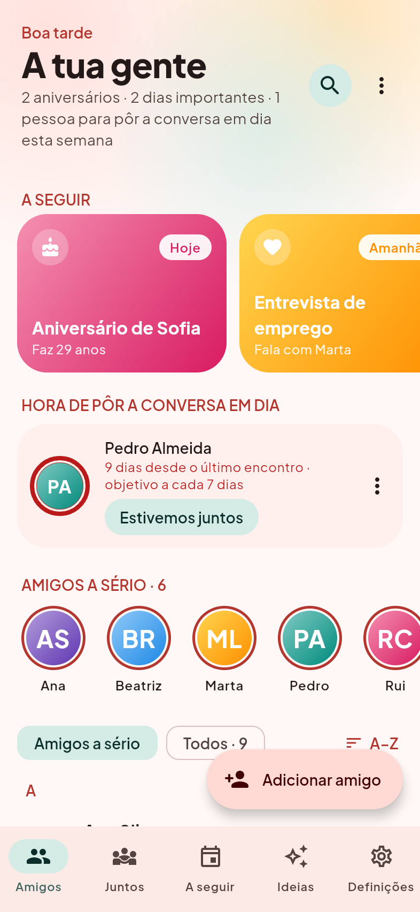</p>

### 🌗 Light & dark

<p align="center">
  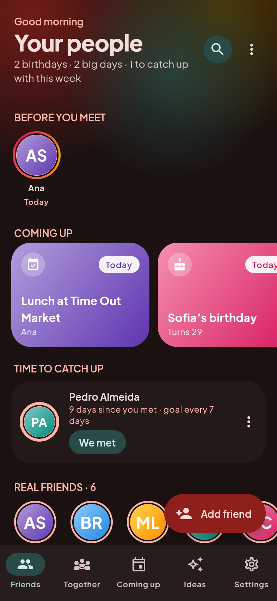
  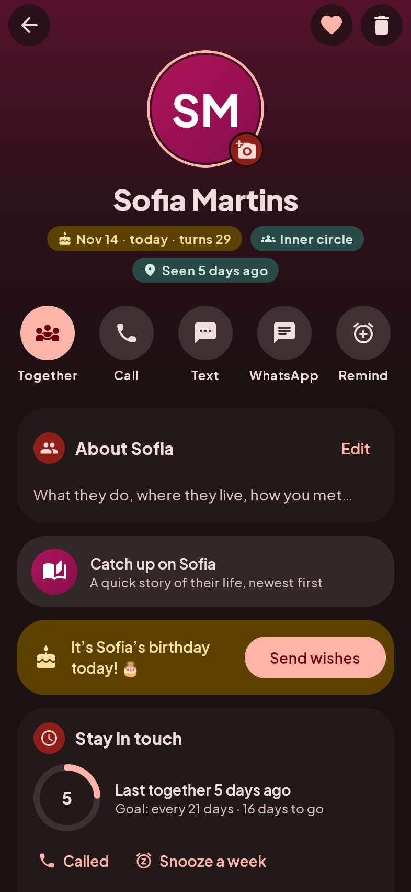
  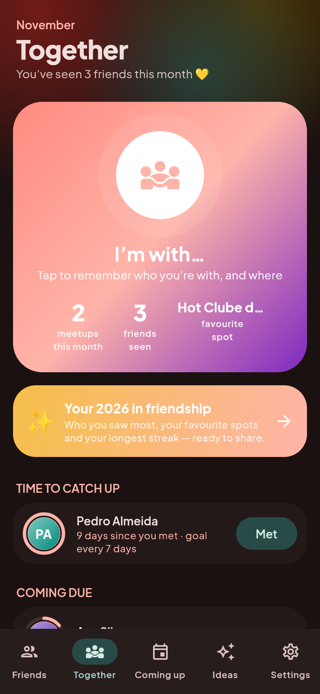
  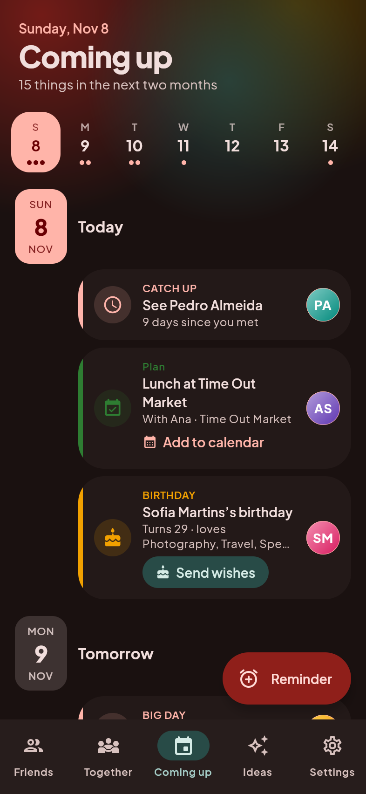
</p>

### 👋 First run & settings

<p align="center">
  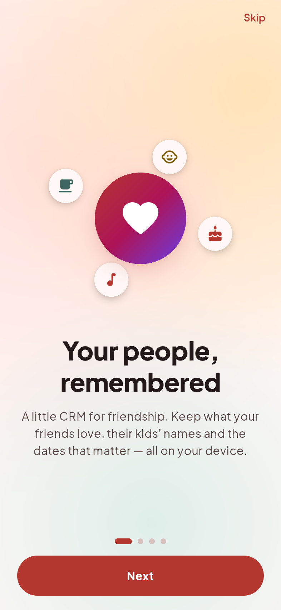
  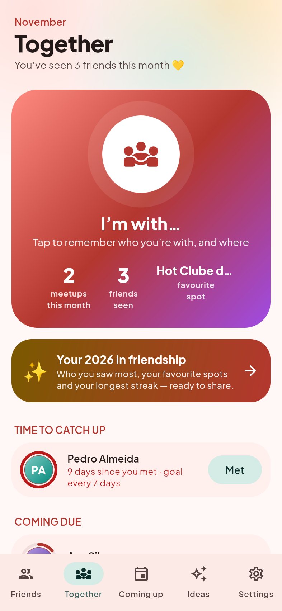
  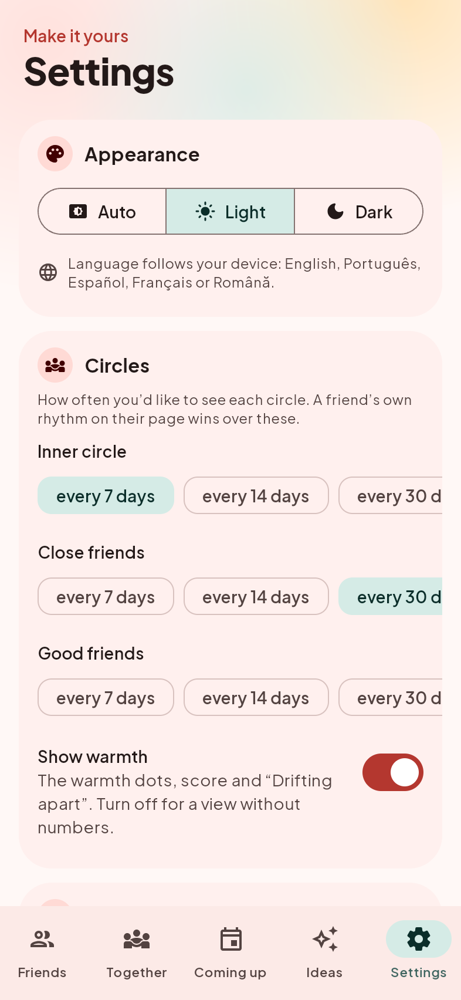
</p>

A short animated intro with permission primers *before* any system dialog, and an **“Explore with sample friends”**
option so you can try everything before importing your own contacts (remove the sample anytime in Settings).

### 🖥️ On the web, too

<p align="center">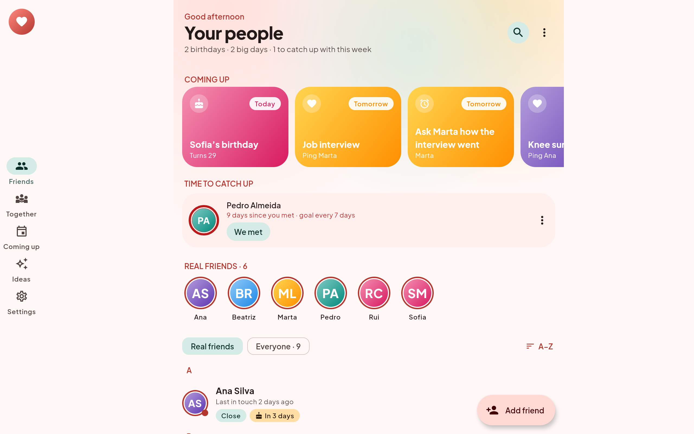</p>

Wide screens get a navigation rail and a centred content column. The web build stores data in the browser and adds
friends by hand (browsers have no address book).

> Screenshots are rendered from the **real shared Compose UI** (the web build, in headless Chromium) — the same code
> that runs on Android and iOS. Regenerate them with the [`capture-screenshots`](.claude/skills/capture-screenshots/SKILL.md) skill.

## 🎨 Design

- **Material 3**, a warm coral/teal/sunflower palette, **Material You dynamic colour** on Android 12+, and smooth animated theme switching.
- **Plus Jakarta Sans** throughout ([OFL](docs/licenses/PlusJakartaSans-OFL.txt)).
- **Motion with purpose**: shared-element avatar transitions, drifting colour blobs behind headers, a pulsing check-in button, a heart burst when you log time together, animated rings, counters and list changes.
- **Edge-to-edge** on Android (with splash screen, adaptive + themed icon, predictive back) and iOS (light/dark app icons, privacy manifest).
- **Usable**: undo for destructive actions, haptics, 48 dp touch targets, semantic headings and content descriptions, sticky A–Z list, search by taste.

## 🔒 Privacy

- No account, no server. Everything lives on your device.
- On Android (Play) you **pick** people with the system contact picker, so the app never sees your whole address book. Full address-book sync and call matching exist only in the separate *sideload* build (Play restricts those permissions). **SMS are never read.**
- WhatsApp and Messenger can't be read by any app; you can import a WhatsApp chat **export** per friend.
- The only network traffic is what you start: AI requests with **your** key to `api.anthropic.com`, and Google Drive backups.
- Optional **app lock** (fingerprint, face or device PIN) and **private lock-screen notifications**.
- **Export / restore** everything as one file, or **back up to your own Google Drive** (the app can only see its own backup file there). Your API key is never in it. Setup: [docs/GOOGLE_DRIVE.md](docs/GOOGLE_DRIVE.md).
- Prefer fewer numbers? Turn off **Show warmth** in Settings.

## 🚀 Getting started

**Just want to try it on Android?** Every merge to `main` publishes installable test APKs on the [`test-build`](https://github.com/neteinstein/Good-Company/releases/tag/test-build) pre-release ([details](CI_CD.md#test-builds)).

Requirements: JDK 21, Android SDK (API 37), and Xcode on macOS for iOS.

```bash
./gradlew :androidApp:installDebug
```

```bash
./gradlew :composeApp:wasmJsBrowserDevelopmentRun
```

For iOS, open `iosApp/iosApp.xcodeproj` in Xcode and run the **iosApp** scheme. The Kotlin framework is built automatically by a Run Script phase.

On the web, add `?demo` to the URL to load the sample circle (`?demo&tab=together&theme=dark` also works).

## 🧱 Architecture

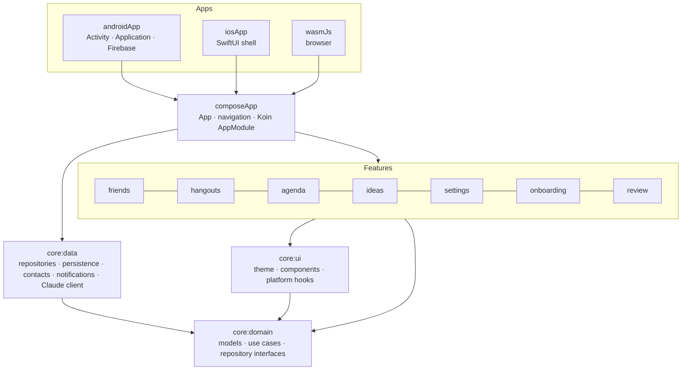

Kotlin Multiplatform with **commonMain-first** code, MVVM with `StateFlow`, Koin for DI, and one Gradle module per feature.
Tests live in `commonTest` and run on the JVM. See **[AGENTS.md](AGENTS.md)** for conventions and gotchas, and
**[CI_CD.md](CI_CD.md)** for the pipeline. The product spec is **[docs/PRODUCT_BRIEF.md](docs/PRODUCT_BRIEF.md)**.

| | |
|---|---|
| UI | Compose Multiplatform 1.12 · Material 3 · Navigation (type-safe) |
| Logic | Kotlin 2.4 · Coroutines/StateFlow · kotlinx-datetime/serialization |
| DI / Net | Koin 4.2 · Ktor 3.6 |
| Storage | JSON documents in multiplatform-settings (SharedPreferences · NSUserDefaults · localStorage) |
| AI | Claude Messages API with web search (user-supplied key) |
| Quality | kotlin.test · Kover · ktlint (Spotless) · Android Lint · R8 |

## 🤝 Contributing

Conventional Commits (`feat(friends): …`), a PR template with a mandatory test plan, and CI that builds Android, iOS
and Web, and runs the tests, coverage gate and linters on every PR.
