# V1 batch 2: issue plan (2026-11-14)

18 backlog items → **13 issues**. Base: `origin/main` @ `86e8fd1`. Issue bodies are in English, like #20–#25.

## Order and dependencies

```
I1  Pick from contacts → checkbox list (A1)          independent
I2  Friend page basics: birthday, name, photo         independent      (migration)
I3  Settings: AI switch and activity list (F1, F3)    independent      (migration)
I4  Shared tags (F16)                                 independent      (migration)
I5  Links between people (F6, F18)                    ─┐               (migration)
I6  Kids are people (F9)                               ├─ after I5     (migration)
I7  Automatic kinship (F7)                             ├─ after I6
I8  Gift lists per occasion (F8)                       └─ after I7 (search by kinship); circles already exist
I9  Plans with a circle, recurring plans (F20)        independent      (migration)
I10 Named places (F11)                                independent      (migration)
I11 Calendar suggestions (D3, F2)                     after I10 is nice-to-have, not required
I12 Network map and dashboard                         after I5 (map edges)
I13 "We met" opens a small panel (F2)                 independent      (no migration); I3 adds the activity list it uses
```

**Running them overnight:** almost every issue adds a `.sqm` migration (the last is `6.sqm`). Two branches built in
parallel will both take `7.sqm` and clash. Run them **one at a time, each from the previous merge**. To run them in
parallel anyway, give each issue its migration number up front and merge in that order.

## Open questions (defaults used below unless you say otherwise)

1. **F9 and relatives.** F9 turns *kids* into people. Partner, parents and siblings (`Relative`) are still names inside
   a friend, and F18 adds a separate partner link between two people. Default: kids become people (F9). A `Relative`
   can be **turned into a person** with one tap ("Add as a person"), which creates the link. There is no automatic
   migration of relatives.
2. **F6 "Family can form an automatic circle".** Default: yes, a built-in "Family" circle whose members are everyone
   with a relation to me. It can't be deleted, only hidden.
3. **Network map edges.** Default: links between people (I5) plus "introduced by". Co-presence in meetups is not an
   edge (that would be a different map).
4. **Mockups.** Done: `docs/mockups/v1-batch2/` (`index.html` + one PNG per issue, linked under each heading below).
   When the issues are created, the image links become `raw.githubusercontent.com/.../<commit SHA>/docs/mockups/v1-batch2/<name>.png`,
   as in #20–#25.

5. **"We met" outside the app (I13).** The widget's "We met" and the notification's "We met" quick action run without
   opening the app. Default: they keep logging today straight away (one tap, as today). Every "We met" **inside**
   the app opens the panel.
---

## I1 · "Pick from contacts" opens the contact list with checkboxes

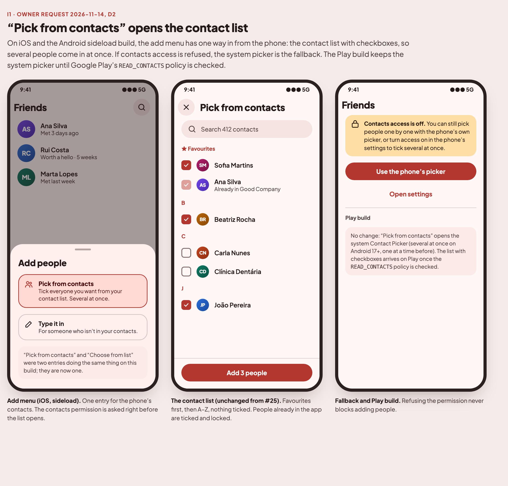

Owner request (2026-11-14), applying **D2** and the 2026-11-14 "Import · where the list ships" decision.

Today the add menu's **Pick from contacts** (`AddFriendOption.PICK_FROM_CONTACTS`, `FriendsScreen.kt`) calls
`rememberContactPicker`. That picker is multi-select only on Android 17+ (`ACTION_PICK_CONTACTS`) and picks one
contact at a time on older Android. The checkbox list (`ChooseContactsScreen`, `ChooseContactsRoute`) already picks
several.

### What to build
- **iOS and Android sideload:** *Pick from contacts* asks for the contacts permission and opens
  `ChooseContactsRoute`. If the permission is refused, it falls back to the system picker, as today. Collapse the
  two menu entries (*Pick from contacts* / *Choose from list*) into one where both would do the same thing.
- **Play build:** unchanged (system picker, multi-select on 17+) until Google Play's `READ_CONTACTS` policy is
  checked. Use `currentPlatformCapabilities()` to tell the builds apart.
- **Web:** unchanged (`.vcf`).
- Onboarding's "add people" step follows the same rule.
- Record the decision in the brief's Decisions table.

### Tests
`FriendsViewModelTest` (which options are offered per capability), `OnboardingViewModelTest`.

### Done when
On iOS and sideload one tap on *Pick from contacts* opens the checkbox list and several people can be added at once.
The Play build is unchanged.

---

## I2 · Friend page basics: birthday reminders on, year optional, editable name, photo crop/remove/replace

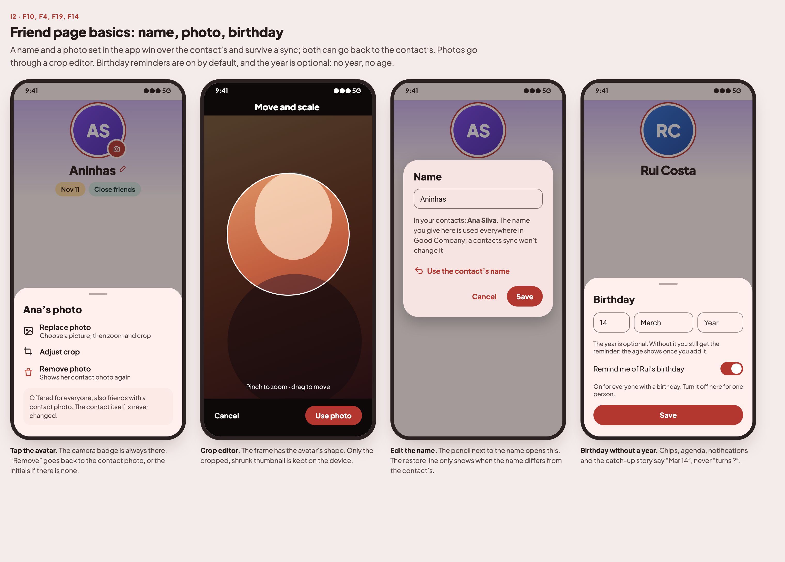

Implements **F10**, **F4**, **F19** and **F14**.

### 1. Birthday reminders on by default (F10)
- `Friend.notifyBirthday` defaults to `true` (`Relative` already does). Migration: turn it on for every existing
  friend who has a birthday. The per-person switch stays.
- Remove "for them and their kids" wording where it assumes the old opt-in. Kids get their own reminder once I6 lands.

### 2. Birthday without a year (F4)
- `Birthday.year` is already nullable. Check every editor (friend, kid, relative, onboarding, `.vcf` import): the
  user can enter day + month and leave the year empty, then add it later.
- With no year, no age is shown anywhere: page, agenda, notifications, catch-up story (`StorySlide.Birthday.turning`),
  widget, year in review.

### 3. Edit a person's name (F19)
- New `Friend.customName: String? = null`. The display name is `customName ?: name`, and every screen,
  notification, widget, share and AI prompt uses it.
- `ContactMerger` keeps updating `name` from the contact but never touches `customName`.
- Edit from the page header. For a person from contacts, offer **Restore the contact's name**, which clears
  `customName`.
- The contact write-back (sideload) never writes the name.

### 4. Crop, remove and replace the photo (F14)
- Upload is offered for **every** friend, not only those without a photo. It opens a crop editor in the avatar's
  shape: pinch to zoom, drag to position. Only the cropped, shrunk JPEG is kept (`PhotoShrinker`, `MAX_SIDE_PX`).
  The editor is a shared composable in `:core:ui`.
- New `Friend.customPhoto: ContactPhoto?`, which takes precedence over `photo`. `ContactMerger` only ever updates
  `photo`. Render with `FriendAvatar`, which picks `customPhoto ?: photo`.
- **Remove** clears `customPhoto`, so the contact's photo or the initials show again. **Replace** goes through the
  editor again.
- Backups carry `customPhoto`; the widget privacy rule applies to it too.
- Update the brief's 2026-11-13 photo rows as superseded where they still say "only while the friend has no photo".

### Tests
`BirthdayTest`, `NotificationPlannerTest` (no age without a year; reminder on by default), `ContactMergerTest`
(custom name/photo survive a sync), `FriendDetailViewModelTest`, `AppDatabaseTest` (migration), backup round trip.

### Done when
A new friend with a birthday gets a reminder. A yearless birthday shows no age. A name and photo set in the app
survive a contact sync and can be reset.

---

## I3 · Settings: AI hidden until it's turned on, configurable activity list

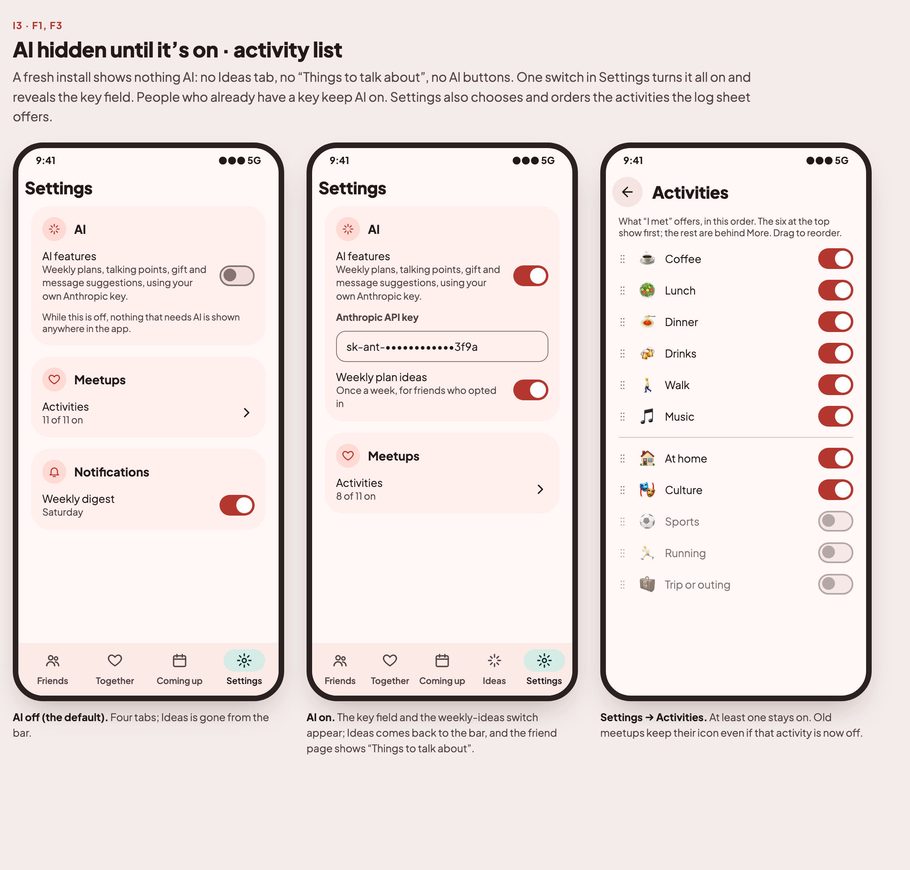

Implements **F1** and the configurable half of **F3**. The latter is listed as "Not yet done" in the 2026-11-14
"Timeline · one Log sheet" decision.

### 1. AI switch (F1)
- New `AppSettings.aiEnabled: Boolean = false`. Migration: `true` for people who already have an API key, so nothing
  disappears for them.
- Settings: an **AI** switch. The API key field shows only when it is on.
- Off: the **Ideas** tab leaves the bottom bar (`Routes.kt` `IDEAS`, `AppNavHost`) and the friend page's
  "Things to talk about" section is gone (the offline talking points stay if they don't need AI). AI buttons also
  disappear everywhere else: gift suggestions, birthday-message personalisation, "suggest a line" on the share
  screen, AI story bits. The weekly job doesn't run.
- `LaunchOptions` `tab=ideas` falls back to Home when AI is off.
- Rule for later work, added to AGENTS.md: every AI entry point checks `aiEnabled`.

### 2. Activity list in Settings (F3)
- New `AppSettings.activities: List<HangoutActivity>`, which defaults to all of them in today's order.
- Settings → **Activities**: turn each on or off and reorder it. At least one must stay on.
- The log sheet's "six most used + More" works on the enabled ones only. An old meetup whose activity is now off
  still shows its icon.

### Tests
`SettingsViewModelTest`, nav test (Ideas tab hidden), `FriendDetailViewModelTest` (no AI section), log-sheet
ViewModel test (respects the list), migration test.

### Done when
A fresh install shows no AI anywhere until the switch is on. The log sheet shows only the chosen activities.

---

## I4 · Shared tags for likes and dislikes

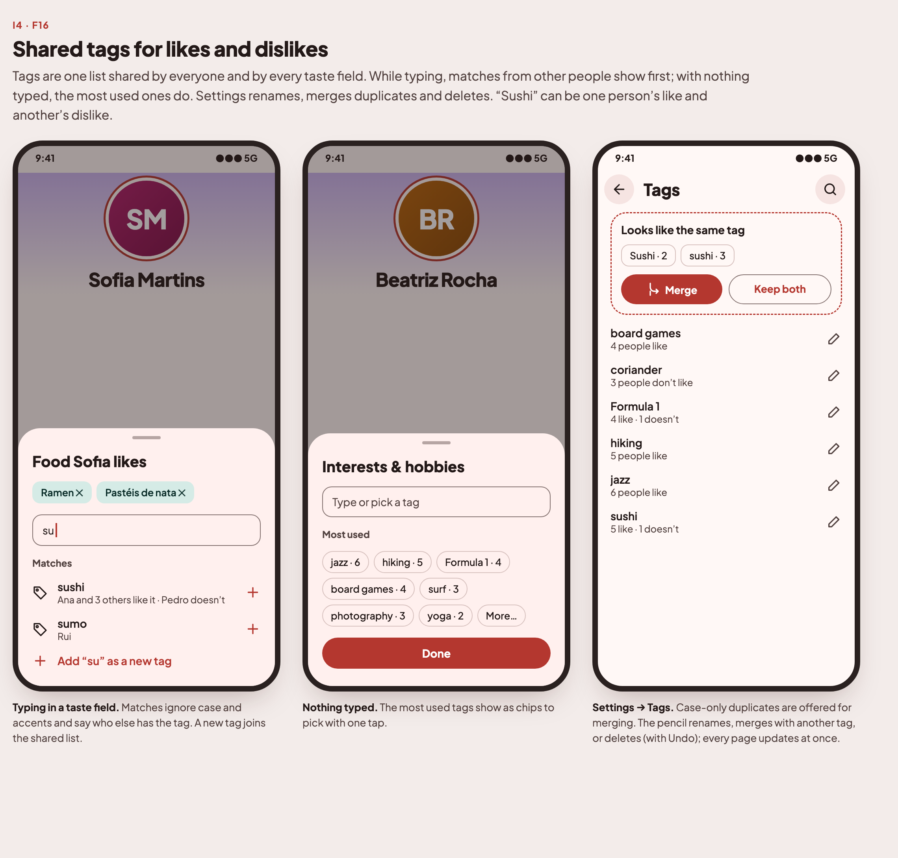

Implements **F16**.

- One tag list shared by everyone. It feeds `likes`, `dislikes`, `food`, `drinks`, `interests` and kids' and
  relatives' likes.
- Table `tag(id, name, normalized)`. Friend lists keep storing the text, so backups and the domain stay readable.
  The tag list is the set of every name in use plus the ones in the table. Pick whichever is simpler, as long as
  renames and merges update every friend in one transaction.
- `TagEditor` (`:core:ui`): besides typing, it suggests the most used tags as chips. Typing shows matches, ignoring
  case and accents. A new tag joins the list.
- Settings → **Tags**: rename, **merge** (e.g. "Sushi" + "sushi"; offer the case-only duplicates automatically) and
  delete (removes the tag from every person, with Undo).
- A tag can be one person's like and another's dislike.
- Backup: restore re-creates the list. `SampleData` uses overlapping tags.

### Tests
A domain test for normalization, merge and rename across all fields; `TagEditor` suggestion ordering; a Settings
ViewModel test; `RepositoryContract` for the new table.

### Done when
Typing "su" on any page suggests "sushi" from other people. Merging two spellings fixes every page at once.

---

## I5 · Links between people, relationship to me, romantic relationships

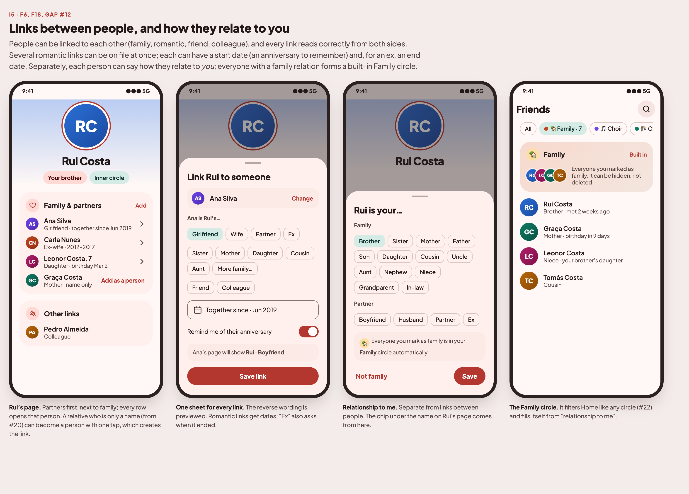

Implements **F6** and **F18**, and the V1 spec's "links between contacts" (gap #12). This is the foundation for I6,
I7 and I12.

### Model
- New `PersonLink(id, from: FriendId, to: FriendId, type: LinkType, startedOn: LocalDate?, endedOn: LocalDate?,
  note)`, in its own table, in `Backup` and in `replaceAllData`.
- `LinkType`:
  - family: parent / child, sibling, grandparent / grandchild, aunt-uncle / niece-nephew, cousin, in-law
  - romantic: boyfriend/girlfriend, husband/wife, partner, ex
  - other: friend, colleague
- Every link is **reciprocal**, stored once and shown from both sides with the right word ("Ana is Rui's girlfriend"
  ↔ "Rui is Ana's boyfriend"). Gendered words need a gender-neutral fallback, so add an optional `Friend.pronouns`
  or pick neutral copy. Decide in the PR and record it.
- **Several romantic links at once** are allowed. A romantic link's `startedOn` can be an **important date**
  (anniversary), with the reminder rules of `ImportantEvent`. An `ex` has an `endedOn`.
- **Relationship to me (F6):** `Friend.relationToMe: LinkType?` (sister, son, mother, cousin…), separate from
  person↔person links.
- **Family circle (F6, question 2):** a built-in "Family" circle of everyone with a family `relationToMe`.

### UI
- Friend page "Family" card: links next to kids and relatives, partner first (F18). Each person links to their page.
  "+ Link to a person" (friend picker + type).
- Header: "Sister" / "Your cousin" line from `relationToMe`.
- A `Relative` card gets **Add as a person**, which creates a friend and a link (question 1).
- Sideload write-back: links become contact relations, as "introduced by" already does (2026-11-13 decision).

### Tests
Reciprocity and wording, several partners, an ex with an end date, an anniversary reminder from `startedOn`, the
family circle, migration, backup round trip.

### Done when
Marking Ana as Rui's girlfriend shows on both pages. Ana can be "my sister", and Family appears as a circle.

---

## I6 · Kids are people

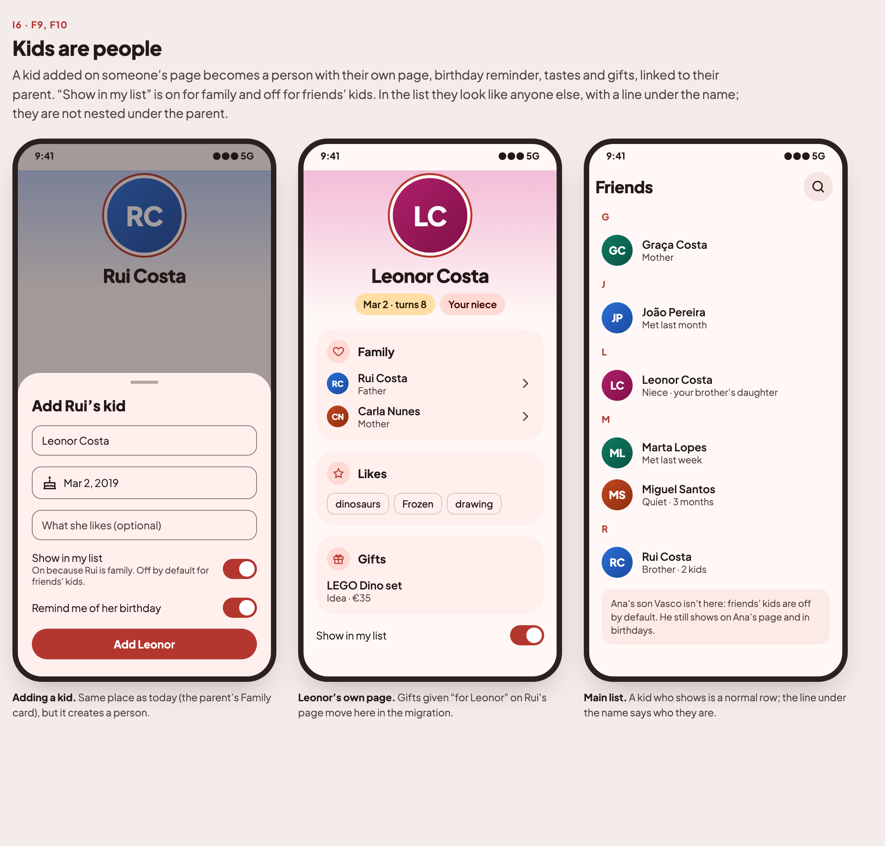

Implements **F9** (and the kids half of **F10**). **Do after I5.**

- Every `Kid` becomes a `Friend` with a parent link (I5) to the friend it belonged to. Migration in one transaction:
  keep the id where possible, move birthday and likes, and remap `Gift.forKidId` to the new person
  (`Gift.forKidId` → the gift moves to the kid's own page).
- New `Friend.showInMyList: Boolean`. It is on by default when the person has a family `relationToMe` (or is the kid
  of someone in Family), and off for friends' kids.
- Main list: kids who show appear **like anyone else** (not nested), with a line under the name: "Niece · your
  brother's daughter" once I7 exists, "Ana's daughter" before.
- The parent's page still lists their kids (now links to their pages). Each kid has their own birthday reminder.
- The catch-up story, agenda, notifications, widget, AI prompts, sample data, `.vcf` and the contact write-back
  (kids as children rows) keep working off the links.
- `Kid` stays only for reading old backups (restore converts them).

### Tests
Migration (gifts follow, ids stable), old-backup restore, list visibility rules, agenda/notifications for a kid
person, catch-up story.

### Done when
Adding a kid on Rui's page creates a person with their own page and reminder, hidden from the main list unless family.

---

## I7 · Automatic kinship

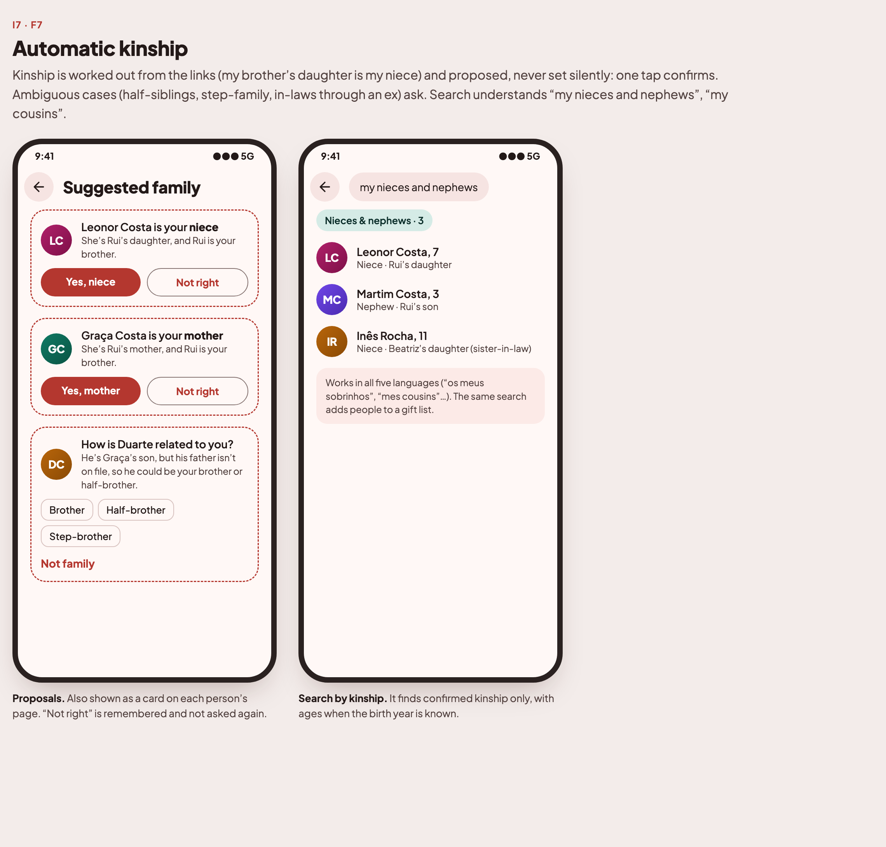

Implements **F7**. **Do after I6.**

- A pure domain `KinshipResolver`: given `relationToMe` and the links, it proposes kinship for people one or two
  steps away (my brother's daughter → niece; my mother's sister → aunt; my partner's mother → mother-in-law).
- Proposals show on the person's page and in a "Suggested family" list. **One tap confirms** and sets
  `relationToMe`; dismissing is remembered.
- Ambiguous cases are proposed with the choice open, never auto-set: half-siblings (one shared parent), step-family,
  in-laws through an ex.
- **Search by kinship:** the Home search understands "my nieces and nephews", "my cousins" (in all five languages)
  and so does the friend picker used by I8. Keep the vocabulary in `:core:ui` resources, not in domain code.
- The I6 subtitle uses the confirmed kinship ("Niece · your brother's daughter").

### Tests
A table-driven `KinshipResolverTest` (each relation, half-siblings, in-laws, cycles), dismissed proposals, search
parsing per language.

### Done when
Linking my brother to his daughter proposes "niece", and "my nieces" finds her.

---

## I8 · Gift lists per occasion

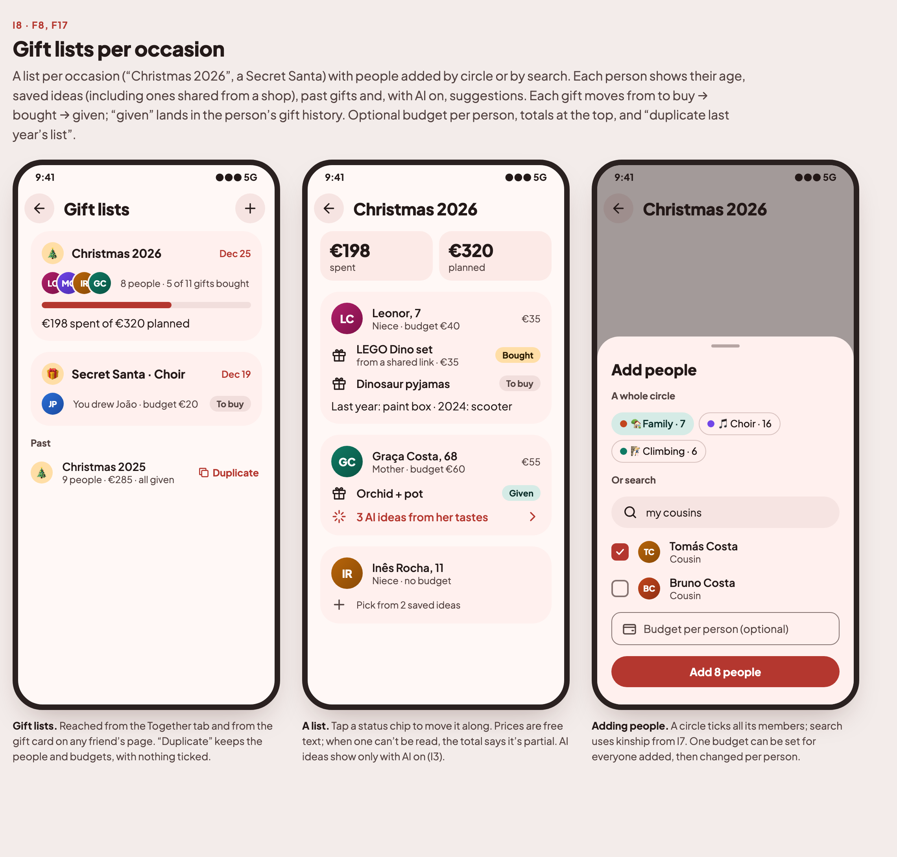

Implements **F8** (and shows the **F17** shared gift ideas). Best after I7 (kinship search); circles already exist.

- New `GiftList(id, title, occasionDate?, createdAt)` and `GiftListEntry(listId, friendId, budget?, items)`. Each item
  links to a `Gift`, with a status **to buy → bought → given**. All of it goes in the tables, the backup and
  `SampleData`.
- Create a list ("Christmas 2026", Secret Santa). Add people **by circle** or **by search** (incl. I7 kinship).
- Each person row shows age (when the birth year is known, I2), saved gift ideas (incl. shared ones with link and
  price), gifts from past years and AI suggestions (only when AI is on, I3).
- **Budget per person** (optional), with total spent vs total planned at the top. Prices are free text today
  (`Gift.price`), so parse a number where possible and say so when a total is partial.
- Marking an item **given** records it as a gift given (`Gift.givenOn`, `GiftOccasion`) on the person's page.
- **Duplicate** last year's list: same people and budgets, nothing ticked.
- Entry point: a "Gift lists" section (Together tab or Agenda; pick one and say why in the PR) plus a link from each
  friend's gift card.

### Tests
Status flow and "given" recording, totals with partial prices, duplicate, add by circle, backup round trip.

### Done when
A Christmas list for the cousins tracks to buy / bought / given with a budget and fills each person's gift history.

---

## I9 · Plans with a circle, recurring plans

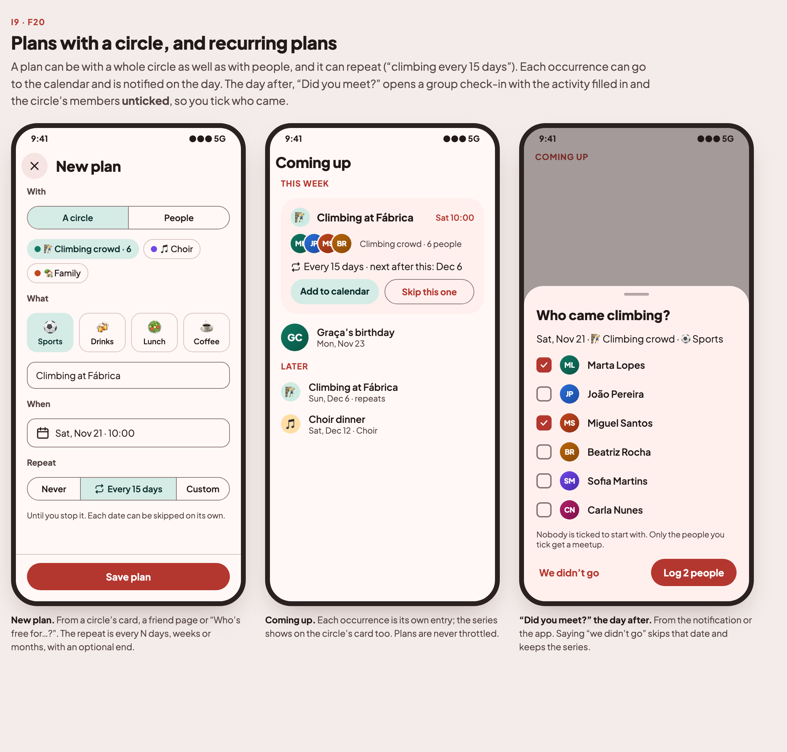

Implements **F20**.

- `Plan.circleId: String?`. A plan can be with a whole circle as well as with individual people.
- Recurrence: `Plan.repeat: Repeat?` (every N days / weeks / months, optional end), generating occurrences on the
  fly or in a table (pick one). Skip one occurrence without ending the series.
- Each occurrence: notified on the day, **Add to calendar** per occurrence (the existing calendar adder / `.ics`),
  and the day after **"Did you meet?"**. A yes opens the log sheet as a group check-in with the plan's activity (F3)
  and **the circle's members unticked** (F20's general rule for group check-ins).
- Plan editor: pick a circle, a repeat and an activity. A circle's page/card shows its next plan.
- Notifications: plans are never throttled (gotcha 16).

### Tests
Occurrence generation (month ends, skip, end date), "Did you meet?" per occurrence, group check-in with nobody
ticked, notification planning, migration, backup.

### Done when
"Climbing every 15 days with the climbing crowd" asks after each session who came and logs it.

---

## I10 · Named places (GPS only)

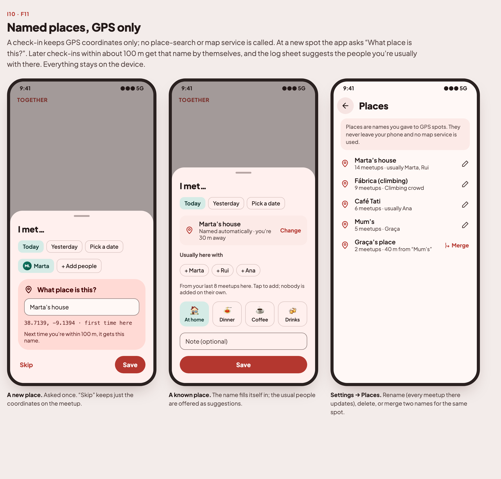

Implements **F11**. No place-search or map services.

- New table `named_place(id, name, latitude, longitude, radiusM = 100)`, in the backup.
- At check-in with location on: if the fix is within the radius of a named place, the place gets its name
  automatically. Otherwise ask **"What place is this?"** (optional: skip keeps just the coordinates in
  `Hangout.place`).
- Manage places in Settings (rename, delete, merge two). Renaming updates the label everywhere.
- Over time, **suggest the people** usually met at that place in the log sheet (most frequent in the last N
  meetups there). It is a suggestion only; nobody is ticked automatically.
- Everything stays on the device. Web: browser geolocation as today; it works the same.

### Tests
Distance matching (haversine, edge of radius, two overlapping places → the nearest), people suggestion ranking,
rename propagation, backup.

### Done when
The second check-in at "Inês's house" names itself and suggests the usual people.

---

## I11 · Calendar suggestions

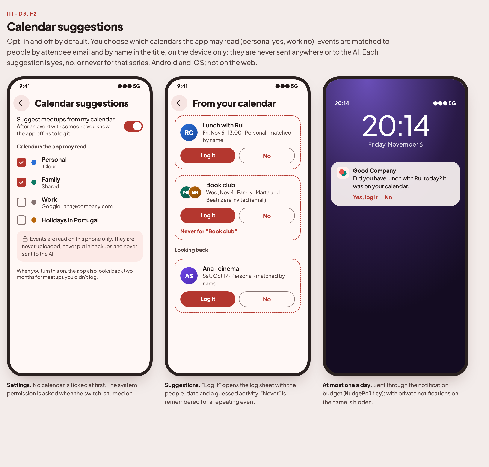

Implements **D3** and the calendar half of **F2**. Android and iOS only; the web doesn't support it (say so in
Settings).

- **Opt-in**, off by default. Settings → *Calendar suggestions*: a switch, then the list of the device's calendars to
  choose from (none ticked).
- `expect`/`actual` reader in `core/data/.../platform/`. Android `READ_CALENDAR` (in both builds; it isn't
  restricted — check and note in the PR). iOS EventKit **full access**: `NSCalendarsFullAccessUsageDescription`
  in all five `InfoPlist.strings`, `PrivacyInfo.xcprivacy`.
- Match events to friends by **attendee email** (`Friend.emails`) and by **name in the title** (reuse the share
  screen's name matching).
- Suggestions: after an event ends, and when the feature is turned on, looking **one to two months back** (F2). Each
  suggestion is **yes** (opens the log sheet prefilled: people, date, activity guess), **no**, or **never for this
  series** (stored; part of the backup).
- Notification: at most one summary a day, through `NotificationPlanner` / `NudgePolicy` (gotcha 16). It is never
  sent anywhere and never given to the AI.
- "Before you meet": upcoming matched events also feed the catch-up story row.

### Tests
Matching (email, name, both, none), dismiss / never rules, look-back window, notification budget, a fake reader in
`:core:testing`.

### Done when
With two calendars chosen, last Friday's "Lunch with Rui" is suggested once and a yes logs it.

---

## I12 · Network map and dashboard

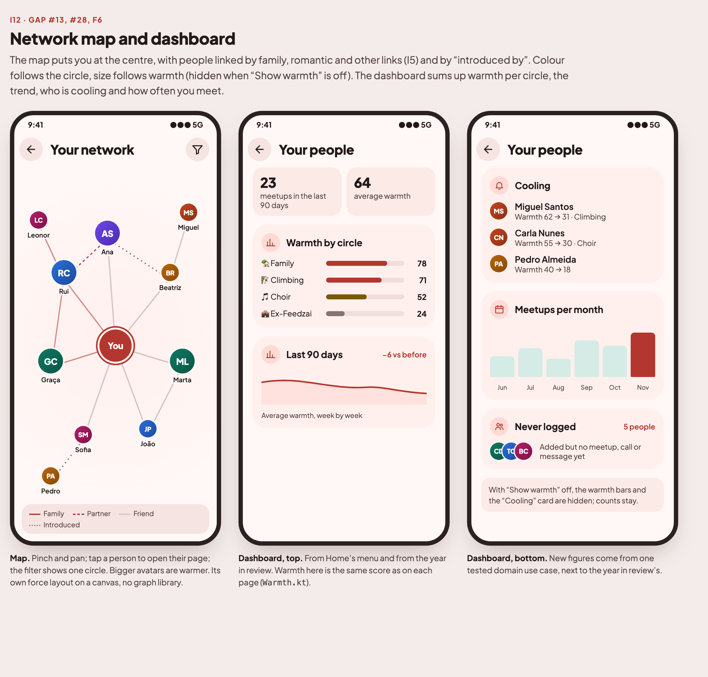

V1 spec gaps #13 and #28. The map part is **after I5**.

### 1. Network map
- A new screen (from Home or Together): me at the centre (F6), people as avatars, edges from links (I5) and
  "introduced by" (question 3). Colour by circle, size by warmth (hidden when *Show warmth* is off).
- Own force-directed layout in a `Canvas` (no graph library in CMP). Keep it fast for a few hundred people: a fixed
  iteration budget, cached positions, and only labels when zoomed in. Pinch, pan, tap a person to open their page,
  filter by circle.
- The layout algorithm is pure and tested in `commonTest`.

### 2. Dashboard
- A "Your people" screen: warmth distribution per circle and per closeness, trend over the last 90 days (from
  meetups/interactions), who is cooling (falling warmth), meetups per month, people never logged.
- It respects *Show warmth* (off → no warmth numbers; counts only).
- Reuse `Warmth.kt` and the year-in-review aggregations (`YearInReview`); new aggregations go in a domain use case
  with tests.

### Tests
Layout determinism and convergence on small graphs, dashboard aggregations, the warmth-hidden path.

### Done when
The map shows my family and friends linked around me. The dashboard shows which circle is cooling.

---

## I13 · "We met" opens a small panel

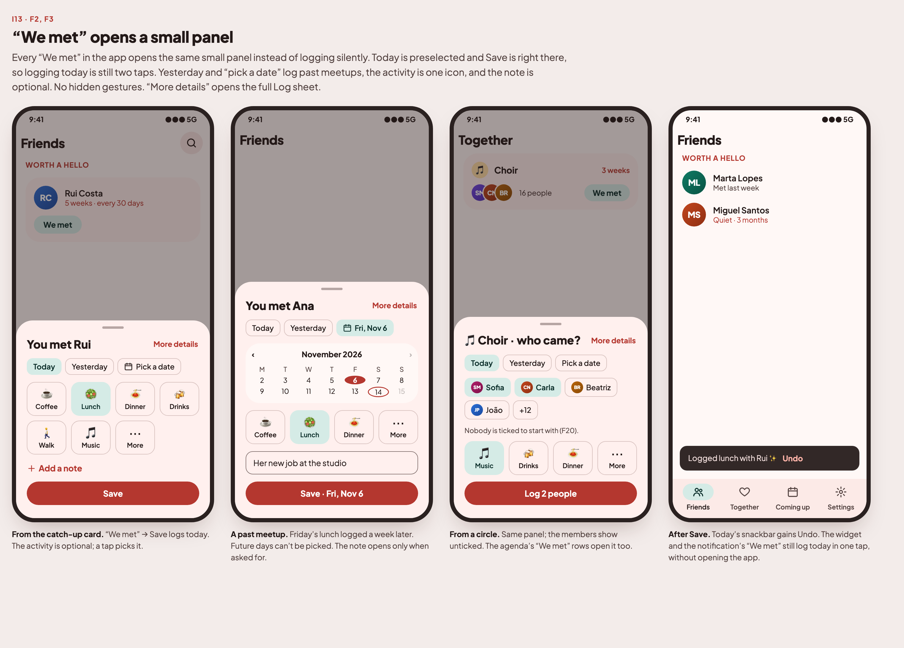

Implements **F2** (2026-11-13) everywhere a "We met" button logs a meetup, and **F3** inside that panel.

Today every in-app "We met" logs a meetup for **today** with no way to change the day or add anything:
`FriendsViewModel.onMetToday` (Home catch-up and drifting cards, `HomeCards.kt`), the agenda's `row_we_met`
(`AgendaRow.kt`) and `AgendaViewModel.onGroupMet`, and the circle's `group_met` on the Together tab
(`HangoutsScreen.kt`). The friend page's "+" opens the full **Log** sheet (`LogInteractionRoute`, #21), which already
follows F2/F3 but is a full-screen dialog with every contact type.

### What to build
- A **small panel** (a compact bottom sheet in `:feature:hangouts`, reusing the #21 log sheet's state and use cases,
  not a second copy of the logic):
  - who: the friend or circle the button belongs to, as chips (a circle's members are **unticked**, F20 rule);
    "+ Add people" for more;
  - **Today** preselected, **Yesterday**, **Pick a date** (no future dates);
  - the activity icons (F3): the six most used plus More, from the I3 list when that has landed;
  - "+ Add a note" (collapsed until tapped);
  - **Save** in reach, so the common case is two taps: "We met" → Save.
  - "More details" opens the full Log sheet with what was chosen so far.
- Every in-app "We met" opens it: Home catch-up/drifting cards, agenda rows (person and circle), Together's circle
  cards, the "Did you meet?" plan follow-up when answered from inside the app, and the friend page.
- No hidden gestures (F2): no press-and-hold alternatives.
- After Save, the existing snackbar ("Logged time with Rui ✨") gets **Undo**.
- Outside the app (question 5): the widget and the notification action keep logging today directly.
- Calendar look-back (F2's last sentence) belongs to I11.

### Tests
A ViewModel test for the panel (defaults to today, yesterday/date, no future dates, circle members unticked, note
optional), the callers no longer call `checkIn` directly (`FriendsViewModelTest`, `AgendaViewModelTest`,
`HangoutsViewModelTest`), Undo removes the hangout.

### Done when
Tapping "We met" anywhere in the app opens the small panel; "We met" → Save logs today in two taps, and Friday's lunch
can be logged a week later with the right date.

