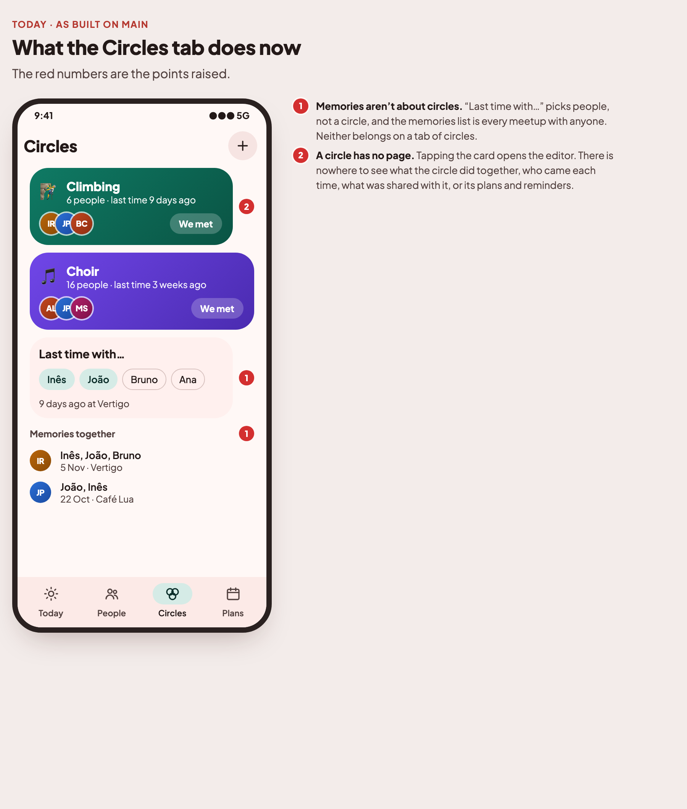
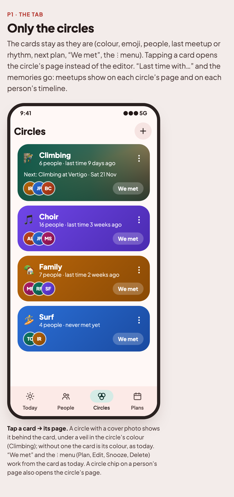
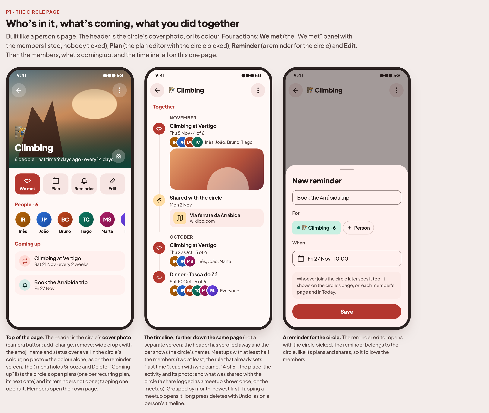

# Circles: a page for each circle (2026-11-14)

Owner review of the Circles tab after the four-tab layout (#65–#72) shipped. Mockups:
[`docs/mockups/v1-circles/`](../mockups/v1-circles/index.html). Decisions dated 2026-11-14 in
[`PRODUCT_BRIEF.md`](../PRODUCT_BRIEF.md) ("Circles tab · only the circles" and "Circles · a page for each circle").
Base: `origin/main` @ `584bc1b` (#86 merged, last migration `19.sqm`). One issue.

**Not created as an issue yet.**

## Owner notes (2026-11-14)

1. "Memories together" on the Circles tab: the link to circles isn't clear.
2. A circle should have a page, like a person. Today tapping a circle only edits it. The page should show more: a
   timeline with the shares and who was at each meetup, and from there make plans, add reminders, etc.

## Owner answers (2026-11-14)

1. **The tab keeps only the circles.** "Last time with…" and the memories list go; meetups show on each circle's page
   and on each person's timeline.
2. **A circle's timeline shows the meetups with at least half its members** (two at least): the same quorum that
   already sets the circle's "last time" (`Relationships.meetupQuorum`). No stored link between a meetup and a circle.
3. **A reminder made on a circle's page belongs to the circle** (stored `circle_id`, like plans and shares), so people
   who join later see it too.
4. **A circle chip on a person's page opens the circle's page** (today it filters the People tab).
5. **The timeline is part of the circle's page**, below the header, actions, people and "Coming up": one scrolling
   page, not a separate screen.
6. **A circle can have a cover photo**: it fills the page header (wide crop) and sits behind the circle's card on the
   Circles tab, under a veil in the circle's colour. No photo = the colour, as today.

---

## P1 · Circles: a page for each circle

### What's wrong today
1. "Last time with…" picks people, not a circle, and "Memories" lists every meetup with anyone. Neither is about
   circles.
2. A circle has no page. Tapping its card opens the editor; there is nowhere to see what the circle did together, who
   came, what was shared with it, or its plans and reminders.

### What to build: the tab (`feature/hangouts`)
- `HangoutsScreen` shows the header ("+" new circle) and the circle cards only, as built in #67 (colour, emoji, people,
  last meetup or rhythm, next plan, "We met", ⋮ menu: Plan, Edit, Snooze, Delete). Order unchanged.
- **Tapping a card opens the circle's page** (`CirclePageRoute(id)`), not the editor.
- **Remove "Last time with…" and the memories list**: the filter, `lastTogether`, `history`, the delete-memory action
  and its Undo, `ObserveHangoutHistoryUseCase` in this ViewModel. Drop the strings nothing else uses
  (`section_last_time_with`, `section_memories*`, `memories_empty_*`, `delete_memory`, `msg_memory_deleted`,
  `last_together*`, `never_all`, `clear`…; check each). If `ObserveHangoutHistoryUseCase` has no other caller, remove it
  and its tests.
- The empty state ("groups_hint") stays for when there are no circles yet.

### What to build: the circle page (`feature/hangouts`, new screen, `new-screen` checklist)
`CirclePageScreen` / `CirclePageContent` / `CirclePageViewModel` (`viewModel { (id: String) -> … }`), route
`CirclePageRoute(id: String)` wired in `AppNavHost`.
- One scrolling page (a `LazyColumn`): header, actions, people, "Coming up", then the timeline. Once the header
  scrolls away the top bar shows the emoji and name.
- **Header**: the circle's cover photo (below) under a veil in its colour, or the colour alone (`CircleColor` tokens
  from `core:ui`): emoji, name, "N people", last meetup and the rhythm or snooze, the same phrases as the card; a
  camera button to add, change or remove the cover. Back; ⋮ menu with **Snooze** (weekend / a week, only with a rhythm)
  and **Delete** (back to the tab, Undo snackbar).
- **Four actions** (`QuickAction`): **We met** (`WeMetRoute(circleId)`, members listed, nobody ticked), **Plan** (the
  plan editor with the circle picked, as the card's menu does), **Reminder** (the reminder editor with the circle
  picked, below) and **Edit** (the circle editor).
- **People · N**: the members' avatars and first names, scrolling sideways; each opens the person's page.
- **Coming up**: the circle's open plans (a recurring plan once, at its next date) and its reminders not done,
  soonest first; plans open the plan, reminders open the reminder editor. Hidden when empty.
- **Together** (the timeline), grouped by month, newest first:
  - **Meetups** with at least `meetupQuorum(members)` of the circle's current members: title (activity and place, as
    on a person's timeline), date, "4 of 6", the avatars and first names of the members who came (everyone: "Everyone";
    non-members who came are listed after them), the note, and the attached photo if any.
  - **Shares** saved to the circle (`Attachment.circleId`). A share logged as a meetup shows once, on its meetup
    (the same `logId` matching as the person's timeline).
  - Tap a meetup to open it; long press → delete with Undo (`DeleteTimelineEntryUseCase` /
    `RestoreTimelineEntryUseCase`), as on a person's timeline.
  - Empty: a short line pointing at "We met".
- New domain use case **`ObserveCirclePageUseCase(id)`** (pure, `core/domain`): the circle's `GroupStatus`, members,
  plans with that `circleId`, its reminders, and the timeline entries built from hangouts + attachments. Reuse
  `Relationships.meetupQuorum` and the `Timeline` builder's types rather than a second timeline model.
- **The built-in Family circle** gets the same page: no Edit action and no Delete (as its card today); members come
  from "relationship to me".
- **A circle that disappears** (deleted elsewhere) closes the page.

### What to build: reminders for a circle (`persistence-change`)
- `Reminder` gets **`circleId: String?`**. A reminder can have a circle, people, or both (like `Plan`).
- **Migration `20.sqm`** (the last on `main` is `19.sqm`): `ALTER TABLE reminder ADD COLUMN circle_id TEXT;` with **no foreign key**,
  like `plan.circle_id` (11.sqm): a deleted circle reads as none, so Undo on a circle delete brings its reminders back.
  Commit `databases/20.db`; `*_TABLES`, mappers, SQL and JSON repositories, backup export/restore (missing field =
  null), migration and contract tests, fakes.
- `AddReminderUseCase` takes the circle; `ReminderEditor` (`core:ui`) shows the circle chip when one is picked.
- **Who a circle reminder is "for"** = its people + the circle's current members, everywhere a reminder's people are
  read: Today / "Everything coming up" (`AgendaBuilder`), the reminder notification text (`NotificationPlanner`: the
  circle's name rather than every member), each member's page (`CatchUpStory` reminders), the widgets if they list
  reminders. Reminders are never throttled (gotcha 16).

### What to build: the circle's cover photo (`persistence-change`)
- `FriendGroup` gets **`cover: ContactPhoto?`** (a JPEG kept in the app, like a person's own photo; the picked original
  isn't kept). The built-in Family circle isn't stored (`FamilyCircle` is constants), so covers live in their **own
  table keyed by circle id**, which works for Family too (below).
- **Set it** from the camera button on the page header, and from the circle editor (Add cover / Change / Remove):
  pick a picture (`core:ui` text/photo picker as for "Your photo"), then **crop wide**. `PhotoCropDialog` today crops
  round only: give it a shape parameter (round for people, a 16:9 rectangle for covers) rather than a second editor.
  Remove = back to the colour, with Undo.
- **Size**: covers need more than a 256 px avatar. Add a cover limit next to `ContactPhoto.MAX_SIDE_PX` /
  `MAX_BYTES` (e.g. 1080 px on the long side, ~200 KB JPEG) and a `PhotoShrinker` call that takes it; avatars keep
  their limits.
- **Shown** on the page header and as the card's background on the Circles tab, both under a veil in the circle's
  colour so the white text keeps its contrast in light and dark themes. Nowhere else (circle chips stay a dot).
- **Stored** in the same `20.sqm`: `CREATE TABLE circle_cover (circle_id TEXT NOT NULL PRIMARY KEY, cover BLOB NOT NULL);`
  with no foreign key (Family's id has no `friend_group` row). Deleting a circle deletes its cover and Undo puts it
  back (`DeleteGroupUseCase` returns the circle with its cover). Backups carry covers (base64, as people's photos);
  a backup without them restores with none. Drive backup size goes up by at most the covers.
- Sample data: one demo circle with a cover so screenshots show both looks (bundled image under `core:ui` resources,
  sample ids only).

### What to build: from a person's page
- A **circle chip on a person's page opens that circle's page** (today `onOpenCircle` sets the People filter and goes
  to the People tab). Drop the filter-setting call there if nothing else needs it.

### Strings
Page title pieces, cover actions (Add cover, Change cover, Remove cover), "People", "Coming up", "Together", "N of M", "Everyone", the empty timeline line, the Reminder
action: English + pt, es, fr, ro (`add-strings`; Romanian plurals for "N of M" if it is a plural).

### Tests
- Domain: `ObserveCirclePageUseCase`: quorum (2-member circle needs both; 6 members need 3), non-members listed after
  members, shares deduplicated against their meetup, plans and reminders filtered by circle, Family circle members.
  Circle reminders reach members (agenda, member's page) including someone who joined after; a deleted circle's
  reminder keeps its people.
- Cover: crop shape parameter (round vs. wide); shrinker keeps covers within the cover limit and avatars within theirs;
  set / replace / remove (with Undo) from the page and the editor.
- Data: migration test from 19 (reminder `circle_id`, `circle_cover` table); backup round trip with and without `circleId`
  and `cover`; `RepositoryContract` (SQL and JSON).
- ViewModels: `CirclePageViewModel` (state, delete + Undo, snooze, missing circle); `HangoutsViewModel` without the
  history. `AppModuleTest` resolves the new ViewModel.
- Screenshots refreshed (`capture-screenshots`), including a circle page if the web launch options can reach it.

### Done when
The Circles tab shows only the circles; tapping one (or its chip on a person's page) opens its page with its people,
what's coming up and a timeline of its meetups (who came) and shares; from there you log a meetup, make a plan, add a
reminder that belongs to the circle, give it a cover photo, edit, snooze or delete it.
