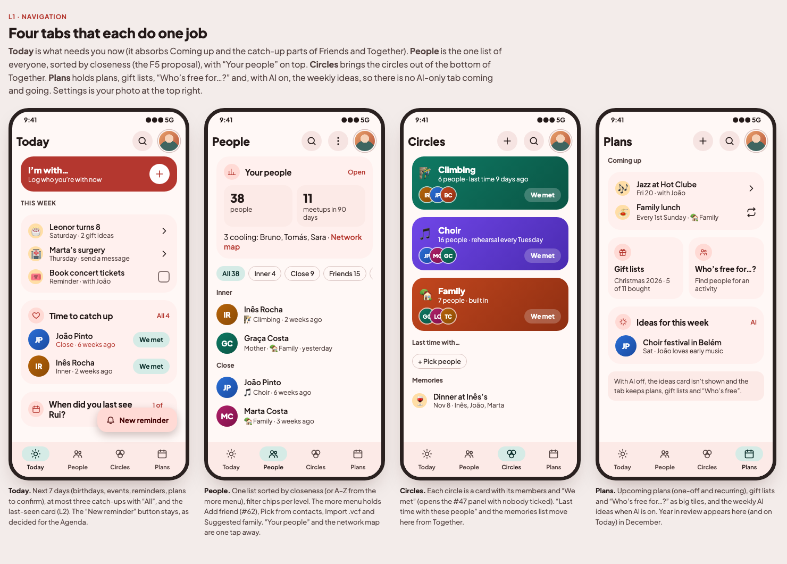
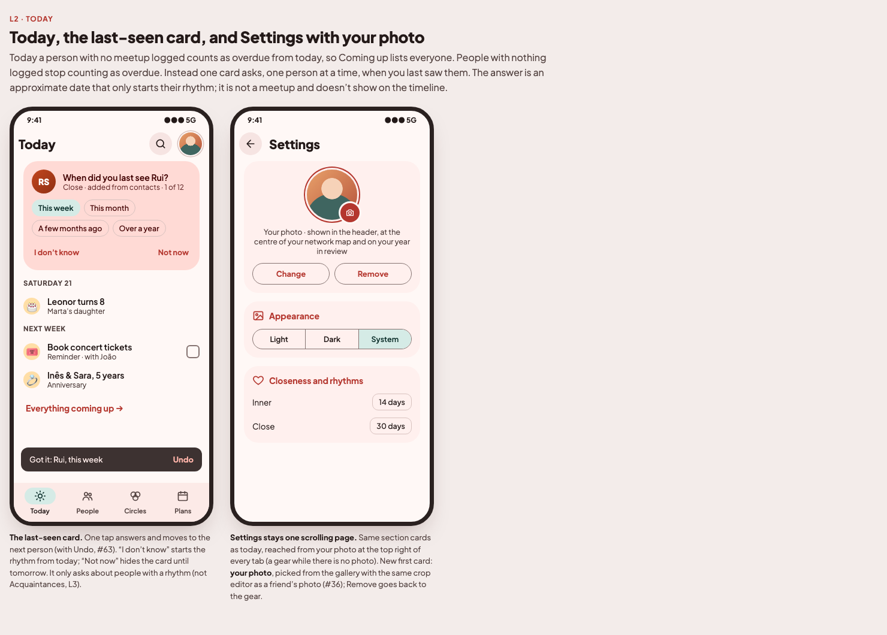
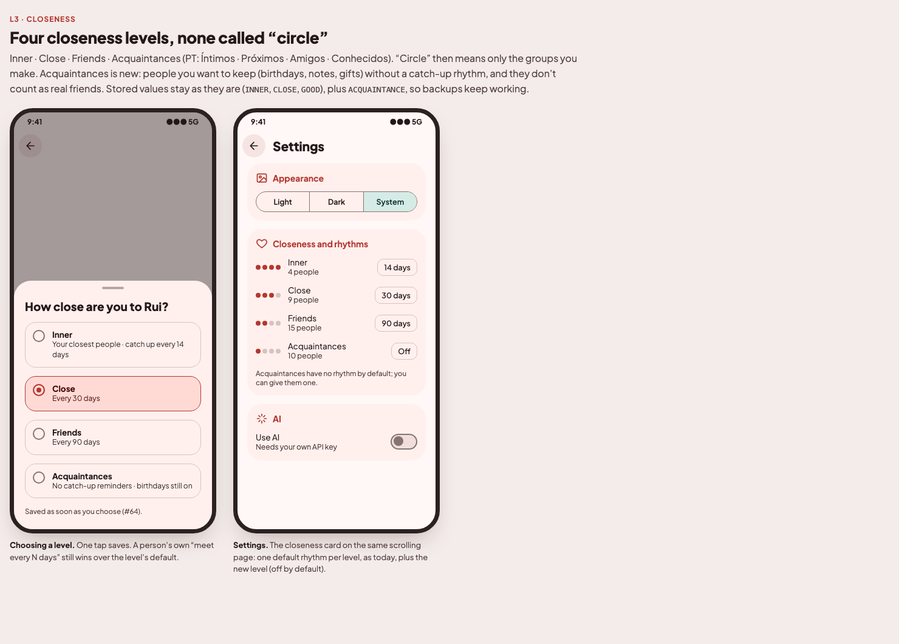
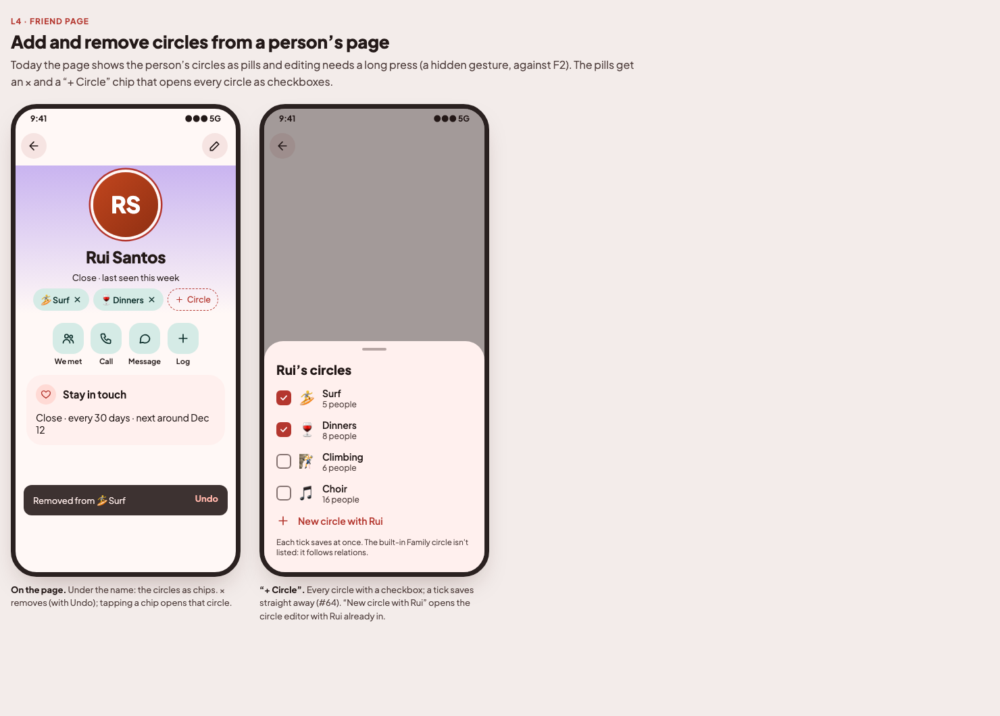

# New layout: issue plan (2026-11-14)

Owner request of 2026-11-14: the main tabs are mostly lists of people, while circles, gift lists, "Your people" and the
network map are hidden at the end of lists or in the ⋮ menu. Mockups: [`docs/mockups/v1-layout/`](../mockups/v1-layout/index.html)
(approved by the owner, with Settings kept as one scrolling page and a photo of you added). Decisions dated 2026-11-14
in [`PRODUCT_BRIEF.md`](../PRODUCT_BRIEF.md). Base: `origin/main` @ `9b4d10e`. Issue bodies are in English, like #35–#47.

**Created as issues (2026-11-14):** N0 #72 · N1 #65 · N2 #66 · N3 #67 · N4 #68 · N5 #69 · N6 #70 · N7 #71. The issues are the live copy.

## Order and dependencies

```
N0  Enum columns without a CHECK                                             first of the migrations  (migration 16)
N1  Four tabs: Today · People · Circles · Plans; Settings from the header   first (navigation shell + Today)
N2  People tab: one list by closeness, "Your people" on top                   after N1; builds on #62
N3  Circles tab and Plans tab                                                 after N1
N4  Never-logged people aren't overdue; "When did you last see…?" card        independent      (migration 17)
N5  Four closeness levels, none called "circle"                               after N0 (#72)   (no migration)
N6  Add and remove circles from a person's page                              independent      (no migration)
N7  Your photo                                                                independent      (migration 18)
```

**Migrations.** N0, N4 and N7 each add a `.sqm` migration (the last on `main` is `15.sqm`). They have their numbers up
front (16, 17, 18); merge them in that order, or renumber with the `refresh-branch` skill. After N0, N5 needs none.
**Overlaps.** N1–N3 move screens between feature modules and `AppNavHost`; run them one after another. #62 (Add friend
in ⋮), #63 (snackbars) and #64 (pickers save on choice) come first or alongside: N2 builds on #62, and N4–N6 use the
#63 Undo helper and the #64 save-on-choice rule.

## Open points (defaults used below)

1. **F5 (Everyone and Real friends).** Confirmed by the owner (2026-11-14): N2's one list sorted by closeness replaces both.
2. **Acquaintances and "real friends".** Default: Acquaintances are not real friends (not in the Home/People "real
   friends" sense, no catch-up rhythm), but keep birthday reminders (F10).
3. **"Who's free for…?"** goes to Plans; **"Last time with…"** and **Memories** go to Circles.

---

## N0 (#72) · Enum columns without a CHECK: new states need no migration

SQLite has no ENUM type: the enum columns are already `TEXT`, but most carry `CHECK (col IN (...))`. SQLite can't change
a `CHECK` in place, so every new value has meant rebuilding the whole table (`3.sqm` `friend_taste`, `4.sqm`
`interaction`, `14.sqm` `person_link`), and N5's new closeness level would be the fourth. Some columns already have no
`CHECK` and read unknown values as null (`friend.preferred_channel`, `hangout.activity`, `plan.repeat_unit`).

### What to build
- Migration `16.sqm` rebuilds the tables whose **enum-value** `CHECK`s go: `friend.circle`, `friend_taste.kind`,
  `friend_occasion.occasion`, `gift.occasion`, `relative.relation`, `interaction.type`, `interaction.source`,
  `idea.kind`, `plan.status`, `attachment.kind`, `attachment.photo_platform`, `attachment.interaction_type`,
  `person_link.type`, `gift_list.occasion`, `gift_list_item.status`, `calendar_decision.kind` (check the `.sq` files for
  the full list). Columns, indexes, foreign keys, defaults and data stay as they are. `0/1` flags and ranges (month,
  day, hour, `id = 1`) **keep** their `CHECK`s.
- **Careful with `friend`:** most tables reference it with `ON DELETE CASCADE`. Rebuild it the way the earlier
  rebuilds did (create `friend_new`, copy, drop, rename) with foreign keys off for the migration, and test that no child
  row is lost.
- Mappers stop using `valueOf` (8 places in `db/*Tables.kt`) and use `entries.firstOrNull { it.name == … }` with a
  fallback chosen per column and written next to it, e.g. closeness → not set; taste kind → like; occasion → none;
  relation → other; plan status → planned; gift item status → to buy; interaction type/source and attachment kind →
  the row is skipped when read (and kept in the table). A newer backup restored into an older build then degrades
  instead of failing.
- Update the `Friend.sq` header comment ("enums TEXT with a CHECK"), the `persistence-change` skill (a new enum value
  needs no migration; the "wider CHECK" row becomes history) and the `area-people` skill (`LinkType` note).
- Run `generate…GoodCompanyDatabaseSchema` and commit `databases/16.db`.

### Tests
Migration test from 15 (every row survives; an unknown value can now be inserted); a mapper test per column for an
unknown value → its fallback; `RepositoryContract` still passes for SQL and JSON.

### Done when
Adding a value to any of these enums needs no migration, and no unknown stored value can crash a read.

## N1 (#65) · Four tabs: Today · People · Circles · Plans, Settings from the header




Today the bar is Friends · Together · Coming up · Ideas (AI only) · Settings, and three of those tabs show lists of
people.

### What to build
- `TopLevelDestination` becomes **TODAY, PEOPLE, CIRCLES, PLANS** (no AI-only tab, so `isShown(aiEnabled)` goes away).
  New labels and icons in all five languages.
- **Settings leaves the bar.** Every tab header shows, at the top right, your photo (N7), or a gear while there is none,
  which opens `SettingsRoute` as a normal screen with a back arrow. **Settings stays one scrolling page** with its
  section cards, as today.
- **Today** (this issue) replaces Coming up as the first tab and absorbs the catch-up parts of Friends and Together:
  - "I'm with…" check-in at the top (from Together);
  - the next 7 days from `AgendaBuilder` (birthdays, events, reminders, plans to confirm), then "Everything coming up"
    for the full agenda;
  - **at most three** catch-ups with "All N" (the rest on the full list), "Before you meet" stories, the drifting card;
  - the last-seen card from N4 when that has landed;
  - the "New reminder" button stays (decision 2026-11-14).
- `LaunchOptions` `?tab=` accepts the new names; the old ones map across (`friends`→people, `together`→circles,
  `agenda`→today, `ideas`→plans, `settings` opens Settings). App-icon shortcuts and deep links keep working.
- Start tab: Today.

### Tests
`LaunchOptionsTest` (new names, old names mapped, no AI-only tab), `AppModuleTest` resolves the Today ViewModel, a Today
ViewModel test (7-day window, three catch-ups max, check-in present).

### Done when
The bar shows Today · People · Circles · Plans on Android, iOS and web; Settings opens from the header; Today shows
what needs you this week without listing everyone; screenshots refreshed.

## N2 (#66) · People tab: one list by closeness, "Your people" on top


### What to build
- One list of everyone, **grouped by closeness** (Inner, Close, Friends, Acquaintances, then not set), with A–Z as an
  option in the more menu. Filter chips per level with counts; the circle filter row stays.
- A **"Your people"** summary card on top (people, meetups in 90 days, who's cooling) that opens `PeopleDashboardRoute`,
  with a **Network map** link.
- The more menu holds Add friend (#62), Pick from contacts, Import .vcf and Suggested family.
- The old Friends Home sections that moved to Today (N1) are gone from here.
- Implements F5 (confirmed 2026-11-14): this list replaces Everyone and Real friends.

### Tests
ViewModel test: grouping and order by closeness, filter counts, A–Z option.

### Done when
Everyone is in one list sorted by closeness, and the dashboard and map are one tap away.

## N3 (#67) · Circles tab and Plans tab


### What to build
- **Circles** (replaces Together): each circle as a big card in its colour with emoji, member avatars, last meetup or
  rhythm, and **We met** (the #47 panel with nobody ticked); "+" opens `CircleEditorRoute`. Below: **Last time with…**
  and **Memories** (from Together). The built-in Family circle is shown like the others.
- **Plans** (replaces Ideas): upcoming plans, one-off and recurring (with the circle when there is one); **Gift lists**
  and **Who's free for…?** as large tiles; **Ideas for this week** only while AI is on (F1); "+" makes a plan. Year in
  review shows here (and on Today) in December.
- Update the "Gift lists (F8 as built)" decision: lists live on the Plans tab.

### Tests
ViewModel tests for both tabs (circles ordered by last meetup, AI ideas hidden with AI off).

### Done when
Circles and gift lists are reachable from the bar in one tap, and Plans works with AI off.

## N4 (#68) · Never-logged people aren't overdue; "When did you last see…?" card


Today `Relationships.meetupStatuses` makes someone with no meetup due today, so the agenda lists everyone.

### What to build
- A person with a rhythm but **nothing logged** is not overdue.
- A **last-seen card** on Today asks about them one at a time: *This week · This month · A few months ago · Over a year*,
  plus **I don't know** (rhythm starts today) and **Not now** (card hidden until tomorrow). Each answer moves to the
  next person and shows an Undo snackbar (#63).
- The answer is stored as an **approximate last-seen date** on the person (migration `17.sqm`, in backups). It only
  starts the rhythm: it is not a hangout, doesn't count for warmth or stats and doesn't show on the timeline. A real
  meetup later wins.
- Only people with a rhythm are asked (not Acquaintances, N5).

### Tests
Domain: never-logged not overdue; the hint starts the rhythm; a meetup overrides it; backup round trip; migration test.
ViewModel: answer, skip, undo.

### Done when
A fresh import shows no wall of overdue people, and answering the card puts each person on a sensible rhythm.

## N5 (#69) · Four closeness levels, none called "circle"



### What to build
- Levels **Inner · Close · Friends · Acquaintances** (PT: Íntimos · Próximos · Amigos · Conhecidos; also ES, FR, RO).
  "Circle" then only means the groups you make. Rename the `circle_inner/close/good` strings' text (keys may stay).
- New `Closeness.ACQUAINTANCE`. Stored values stay (`INNER`, `CLOSE`, `GOOD`) plus `ACQUAINTANCE`. **No migration**:
  N0 removes the `CHECK` on `friend.circle` (do N0 first).
- Acquaintances: no catch-up rhythm by default (a default can be set in Settings), birthdays on (F10), not "real
  friends" (open point 2), not asked by the last-seen card (N4).
- The closeness picker saves on choice (#64). Settings' closeness card lists four levels.
- Widgets, notifications, the network map and the dashboard handle the new level.

### Tests
Domain (rhythm defaults, real-friends rule), migration and backup round trip with `ACQUAINTANCE`, mapper test.

### Done when
No closeness label says "circle", and someone can be an Acquaintance with no catch-up nagging.

## N6 (#70) · Add and remove circles from a person's page



Today the friend page shows circle pills and editing needs a long press (a hidden gesture, against F2).

### What to build
- Under the name: the person's circles as chips, each with **×** (removes, with Undo #63); tapping a chip opens that
  circle. A **"+ Circle"** chip opens a sheet with every circle as a checkbox (**each tick saves**, #64) and
  **New circle with <name>** (opens the circle editor with the person in).
- The built-in Family circle isn't in the sheet (it follows relations).
- Remove the long-press edit.

### Tests
ViewModel: add, remove, undo, new circle prefilled.

### Done when
Adding Rui to a circle is two taps from his page and needs no long press.

## N7 (#71) · Your photo


### What to build
- First card in Settings: **your photo**, Change / Remove. Picked from the gallery with the friend-photo crop editor
  (#36), stored like `ContactPhoto` (thumbnail, `MAX_BYTES`), in backups (migration `18.sqm`).
- Shown: at the top right of every tab (N1; a gear while there is none), at the centre of the network map, and on your
  year in review cards.
- Never written to contacts, never sent to the AI.

### Tests
Use case + repository (set, replace, remove), backup round trip, migration test.

### Done when
You can set, change and remove your photo, and it shows in the header and the network map.
