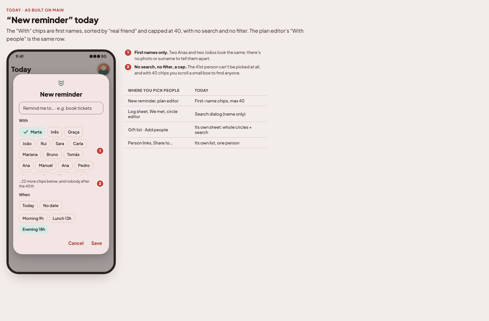
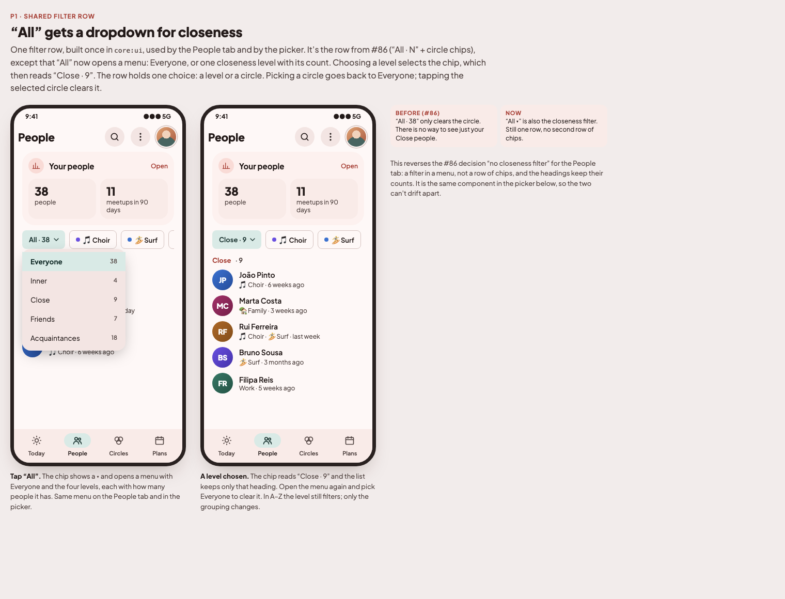
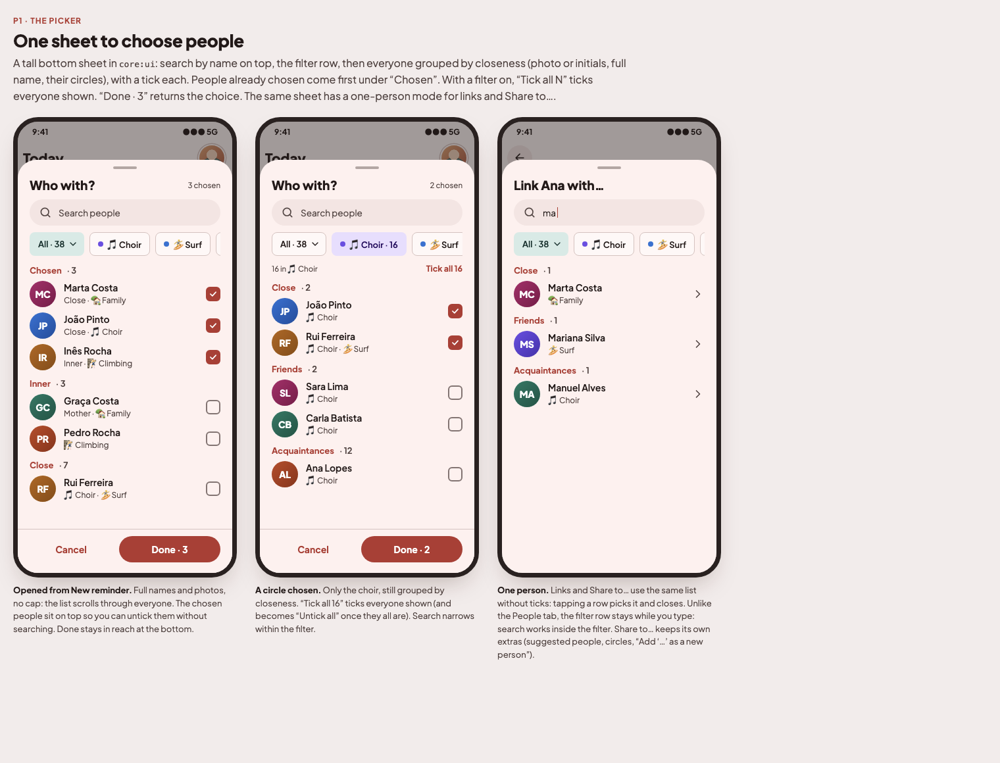
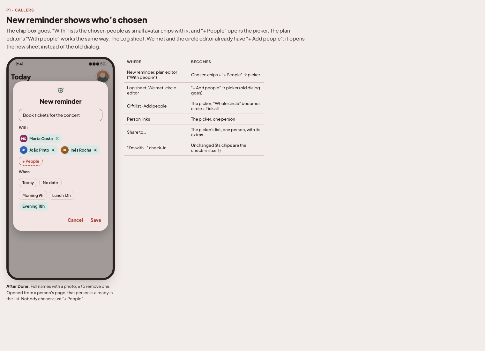

# Choosing people: one picker everywhere (2026-11-14)

Owner note on the "New reminder" popup: instead of pills with people sorted by name, choose people from a popup; make
that a people search popup reused everywhere people are chosen, with search by name and filters by circle and
closeness. Mockups: [`docs/mockups/v1-people-picker/`](../mockups/v1-people-picker/index.html). Decisions dated
2026-11-14 in [`PRODUCT_BRIEF.md`](../PRODUCT_BRIEF.md) ("Choosing people · one picker" and "People tab · closeness in
the All menu"). Base: `origin/main` @ `584bc1b` (the People tab, #86, merged: `AllChip` and the circle filter row). One issue.

**Not created as an issue yet.**

## Owner answers (2026-11-14)

1. **Every place that picks people** uses it: the multi-pick places (reminder, plan editor, Log sheet, We met, circle
   editor, gift list) **and** the one-person places (person links, Share to…).
2. **The filters are the People tab's row**, shared: "All · N" + circle chips. **Tapping "All" opens a dropdown** to pick
   a closeness level. This changes the People tab too.
3. **A tall bottom sheet**; callers show the chosen people as avatar chips with × and a "+ People" button.
4. Mockups: yes.

## Open question (default taken unless the owner says otherwise)

- **Level and circle are one choice, not combined.** The row holds Everyone, one level or one circle. Picking a circle
  resets the level to Everyone; picking a level clears the circle. (Combining "Choir + Close" would need the "All"
  chip to show a level while a circle is selected, which reads as two selections in one row.)

---

## P1 · Choosing people: one picker everywhere

### What's wrong today
1. "New reminder" and the plan editor's "With people" show **first names as chips** (two Anas look the same), sorted by
   "real friend", **capped at 40** (the 41st person can't be picked), with **no search and no filter**.
2. There are six ways to pick people: those chips; `PeoplePicker` (a dialog with name search, used by the Log sheet, We
   met and the circle editor); the gift list's "Add people" sheet (whole circles + search); `PersonPicker` in
   `LinkCards`; and Share to…'s `FriendPicker`. Each looks and filters differently.
3. The People tab can filter by circle but not by closeness (#86 removed the closeness chips).

### What to build: the shared filter row (`core:ui`, `core:domain`)
- **`PeopleFilterRow`** in `core:ui` (next to `CircleChip` / `AllChip`): the "All" chip + one `CircleChip` per circle,
  scrolling sideways, exactly as the People tab's `CircleFilterRow` from #86, which it replaces.
- **The "All" chip gets a ▾ and opens a menu** (`DropdownMenu`): **Everyone · 38**, then the four levels with their
  counts (**Inner · 4**, **Close · 9**, **Friends · 7**, **Acquaintances · 18**; `closenessLabel`). Choosing a level
  keeps the chip selected and relabels it ("Close · 9 ▾"). The chip stays the same size and shape as `CircleChip`.
- **One choice in the row** (see the open question): Everyone, a level, or a circle. Tapping the selected circle (or
  Everyone in the menu) clears it.
- The filter itself is pure domain code: **`PeopleFilter`** (`circleId: String?`, `closeness: Closeness?`) and one
  function that applies it plus a name query to a list of friends, with the level counts. The People tab and the picker
  both call it. Reuse the People tab's existing circle-membership rules (incl. the built-in Family circle).
- **People tab** (`feature/friends`): `FriendsViewModel` keeps a `PeopleFilter` instead of just the circle; with a level
  chosen the list shows only that heading (with its count); in A–Z the level still filters. Search hides the row, as
  today. Update `FriendsViewModelTest`.

### What to build: the picker (`core:ui`)
`PeoplePickerSheet` (a `ModalBottomSheet`, tall), replacing `PeoplePicker` in `LogInteractionSheet.kt`:
- Inputs: `everyone: List<Friend>`, `circles: List<FriendGroup>`, `chosen: Set<FriendId>`, a **mode**
  (`Multiple` / `Single`), a title, `onDismiss`, `onDone(Set<FriendId>)` (single: `onPick(Friend)`), and an optional
  `exclude` (e.g. the person whose page it is, for links).
- **Header**: title ("Who with?") and "N chosen". **Search field** (by name, the same matching as the People tab
  search). **`PeopleFilterRow`** under it; unlike the People tab it **stays visible while typing**: search works inside
  the filter.
- **List**: everyone, **no cap**, grouped by closeness with a count per heading (as the People tab). Each row: avatar
  (photo or initials), full name, a short line (relation to me and/or circles), a checkbox.
- **Chosen first**: people chosen when the sheet opened show under "Chosen · N" at the top (not repeated in their
  group), so they can be unticked without searching. Ticking more doesn't move rows while the sheet is open.
- **Tick all N** (multiple mode, only with a filter or a query): ticks everyone shown; "Untick all" once they all are.
  This replaces the gift list's "Whole circle" chips.
- **Footer**: Cancel and **Done · N**, always in reach (not at the end of a scroll; decision "Pickers · save without a
  Save button"). Done with nobody chosen is allowed where the caller allows it (reminder, plan) and disabled where it
  isn't (Log sheet, We met need someone).
- **Single mode**: no checkboxes, no footer; tapping a row returns it and closes.
- Empty search result: "Nobody called ‘…’" (reuse an existing string if one fits).
- Selection, query and filter survive rotation (`rememberSaveable`).

### What to build: the callers
| Where | Change |
|---|---|
| `ReminderEditor` (`core:ui`; Today, Agenda, person's page) | The chip `FlowRow` goes. "With": chosen people as avatar chips with × (full name), then "+ People" → picker. Needs `circles`: the three ViewModels expose them (`ObserveGroupsUseCase` or the existing groups flow). From a person's page, that person starts chosen. |
| `PlanEditor` "With people" (`core:ui`) | Same as the reminder. The "With a circle / With people" switch stays. |
| Log sheet, We met (`WeMetPanel`), circle editor | "+ Add people" opens `PeoplePickerSheet` instead of `PeoplePicker`. Pass circles. |
| Gift list "Add people" (`GiftListScreen`) | The picker replaces its own sheet (circle chips + search + checkboxes); "Whole circle" becomes choose a circle + Tick all. Drop the ViewModel's own `matches`/query/toggle-circle logic and its strings if unused. |
| Person links (`LinkCards.PersonPicker`) | Single mode, excluding the person and people already linked the same way (as today). |
| Share to… (`ShareToFriendScreen.FriendPicker`) | Reuses the picker's list body (search, filter row, grouped rows) in single mode, embedded in the screen; keeps its extras: the suggested people on top (mentioned, same number, seen today, recent), circles as targets, "Add ‘…’ as a new person". |
| "I'm with…" (`CheckInSheet`) | **Unchanged**: its chips are the check-in itself. |

- `PeoplePicker` (the old dialog) and the reminder/plan chip rows are deleted; remove strings nothing uses any more
  (`add-strings`), add new ones in all five languages (title, "N chosen", "Chosen", "Tick all N", "Untick all",
  "+ People", "Everyone", "Done · N").
- Composables stay stateless where they already are; the filtering/counting is the domain function, so no logic lives
  in the sheet beyond holding the query/filter/selection.

### Tests
- **Domain**: `PeopleFilter` application: name query (case, accents as the People tab does), by circle (incl. Family),
  by level, level counts, query + filter, `exclude`.
- **ViewModels**: `FriendsViewModel` with a level filter (only that heading, counts, A–Z); `GiftListViewModel` after
  its sheet goes; Today/Agenda/FriendDetail expose circles for the reminder editor; reminders still save the chosen ids.
- `AppModuleTest` still resolves every ViewModel.

### Out of scope
- "I'm with…" check-in chips.
- Picking circles (the plan editor's circle chips and Share to…'s circle targets stay as they are).
- Contacts picker / "Pick from contacts" (that picks address-book contacts, not people in the app).

### Docs
- Refresh `docs/screenshots/` (`capture-screenshots`): the People tab with the menu, the reminder editor, the picker.
- Skills to load when building: `new-screen` is not needed (no route); `add-strings`, `area-people` (closeness,
  circles, Family), `area-sharing-gifts` (gift list, Share to…), `area-logging` (Log sheet).
