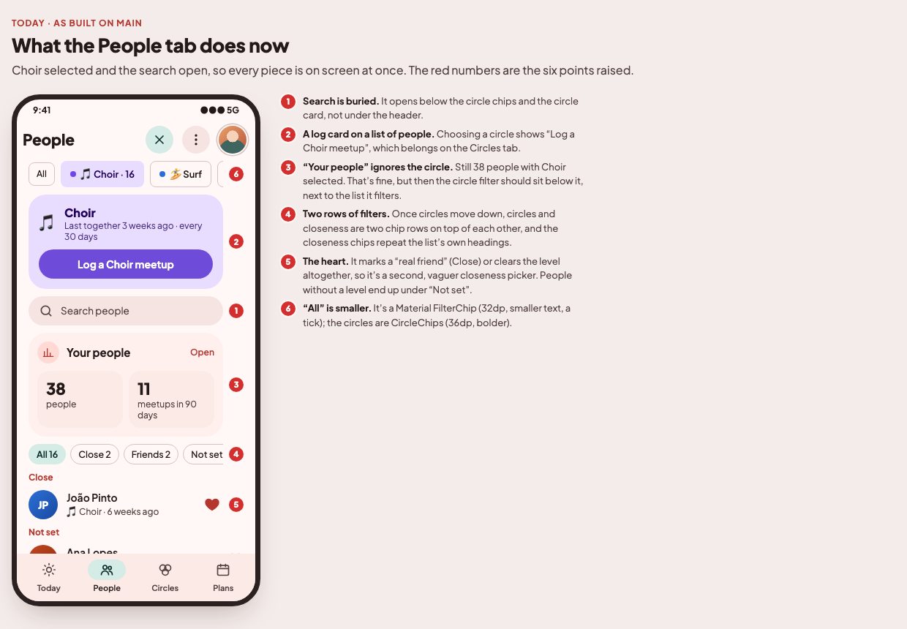
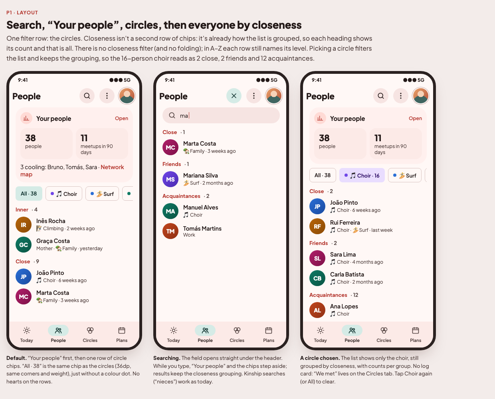
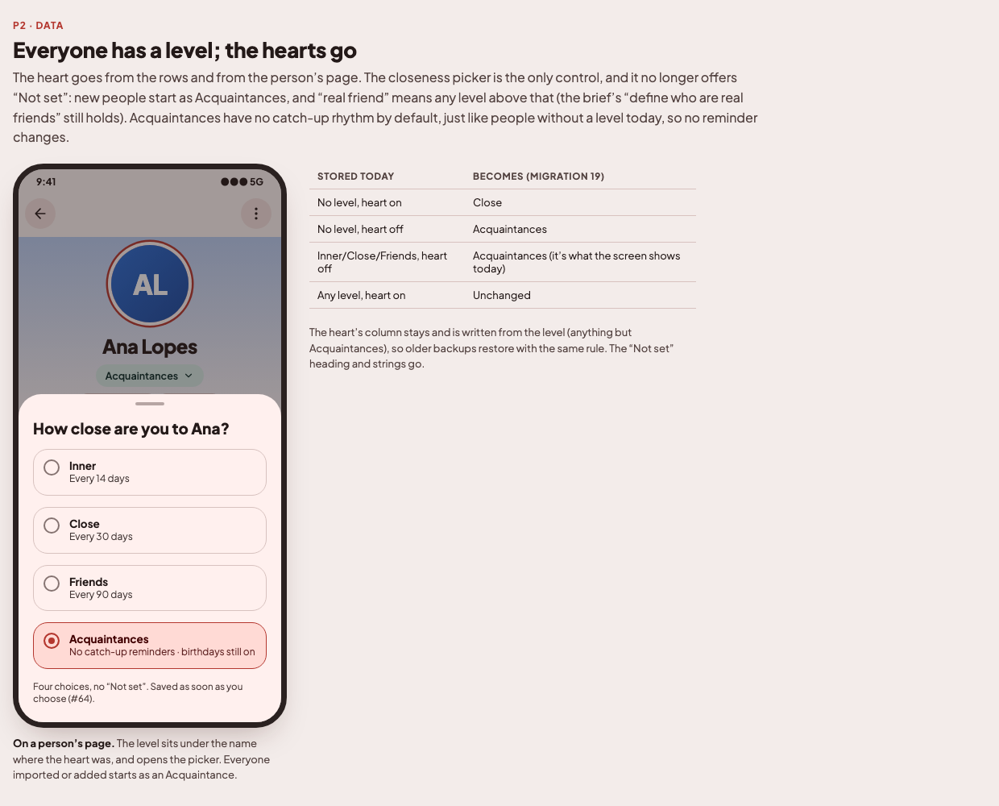

# People tab: issue plan (2026-11-14)

Owner review of the People tab after the four-tab layout (#65–#72) shipped. Mockups:
[`docs/mockups/v1-people/`](../mockups/v1-people/index.html). Decisions dated 2026-11-14 in
[`PRODUCT_BRIEF.md`](../PRODUCT_BRIEF.md) ("People tab · search first, one filter row" and "People · everyone has a
closeness; no hearts"). Base: `origin/main` @ `5ff361a`. One issue, by the owner's choice.

## Owner answers (2026-11-14)

1. **One issue**, not a layout issue plus a data issue.
2. **The heart goes everywhere**: People rows and a person's page.
3. **Migration:** a person with Inner/Close/Friends but no heart becomes an Acquaintance (what the screen shows today).
4. **No folding** of closeness headings and **no closeness filter**: the headings show a count, nothing more.

---

## P1 · People tab: search first, one filter row, everyone has a closeness

### What's wrong today
1. Search opens below the circle chips and the circle card, not under the header.
2. Choosing a circle shows a "Log a <circle> meetup" card on what is a list of people.
3. "Your people" doesn't change with the circle filter, so the filter should sit below it, next to the list.
4. Moving the circles down would leave two chip rows (circles and closeness), and the closeness chips repeat the list's
   own headings.
5. The heart toggles "real friend": on puts someone in Close, off clears the level. It's a second, vaguer closeness
   picker, and people without a level end up under "Not set".
6. "All" is a Material `FilterChip` (32dp); the circles are `CircleChip`s (36dp, bolder), so it looks out of place.

### What to build: layout (`feature/friends`, `core:ui`)
- Order: **header → search field (when open) → "Your people" → circle chips → list grouped by closeness**.
  While searching, "Your people" and the chips are hidden (as today); results keep the closeness grouping.
- **Remove the circle card** (`CircleCard`, "Log a <circle> meetup") from the People tab. "We met" lives on the
  Circles tab. Drop its strings if nothing else uses them.
- **Remove the closeness filter chips** (`LevelFilterRow`, `PeopleFilter`). Each closeness heading shows its count
  ("Close · 9"). No folding. A–Z (more menu) stays as it is.
- Choosing a circle filters the list and keeps the closeness grouping and counts; tapping it again (or All) clears.
- **"All · N" chip the same size and shape as `CircleChip`** (36dp min height, same corners, padding and type, no
  colour dot): add it to `core:ui` next to `CircleChip` rather than styling it in the screen.

### What to build: everyone has a closeness, no hearts
- **Remove the heart** from `FriendRow` and from the person's page (`FriendDetailScreen`). The level shows under the
  name where the heart was and opens the closeness picker; the picker offers four levels, **no "Not set"**.
- `Friend.closeness` becomes **non-null, default `ACQUAINTANCE`**. Every way in starts as an Acquaintance: contact
  sync/picker/list, .vcf import, Add friend, share-to-new-friend (`AddFriendUseCase`'s `isCloseFriend` parameter goes).
- `isCloseFriend` is **derived from the level** (`closeness.isRealFriend`). The `is_close_friend` column and the
  backup field stay and are written from the level, so older builds and backups still read them.
- `SetRealFriendUseCase` goes (both ViewModels' `onToggleClose` too); `SetClosenessUseCase` takes a non-null level.
  `shownCloseness` becomes just `closeness`.
- **Migration `19.sqm`** (last on `main` is `18.sqm`):
  | Stored today | Becomes |
  |---|---|
  | No level, `is_close_friend = 1` | `CLOSE` |
  | No level, `is_close_friend = 0` | `ACQUAINTANCE` |
  | `INNER`/`CLOSE`/`GOOD`, `is_close_friend = 0` | `ACQUAINTANCE` |
  | Any level, `is_close_friend = 1` | unchanged |

  After it, `is_close_friend` = level ≠ `ACQUAINTANCE` for every row. A backup restored from before this change
  goes through the same rule. Commit `databases/19.db`.
- **Nothing changes for reminders or birthdays.** People without a level had no rhythm, like Acquaintances, and
  `is_close_friend` keeps its value for every row, so `AgendaBuilder.caresAbout()` (birthdays), `Cadence`, Today
  and the dashboard see the same people as before. Test it.
- **`ContactMerger.hasAppData()`** counts `closeness != null` as app data (keeps a person whose contact disappeared).
  With everyone having a level this must become "level above Acquaintances", or every orphan would be kept.
- Remove "Not set" everywhere: the `people_not_set` heading and strings, the detail picker's "Not set" chip, the
  "then not set" group, the `LastSeen` sort fallback.
- Check the other readers of `isCloseFriend` / `shownCloseness` (check-in sheet, reminder editor, plans, share,
  circle editor, widgets on both platforms) still read sensibly.
- Update the `area-people` skill (no heart; everyone has a level). The brief's 2026-11-07 row ("Marking someone a
  real friend puts them in Close") is already marked partly superseded.

### Tests
- ViewModel (`FriendsViewModel`): grouping and per-heading counts; circle filter keeps the grouping; no level filter.
- Domain: new people default to Acquaintance; `isCloseFriend` follows the level; `hasAppData` with an Acquaintance
  vs. a Close friend; birthdays and rhythms unchanged for migrated rows.
- Data: migration test from 18 covering every row of the table above; backup round trip, including an old backup
  with a null level; `RepositoryContract` for SQL and JSON.
- Screenshots refreshed (`capture-screenshots`).

### Done when
Search sits under the header, there is one row of filters (circles) with an "All" chip that matches, no log card and
no hearts, and every person has one of the four levels with no change to who gets reminded.
