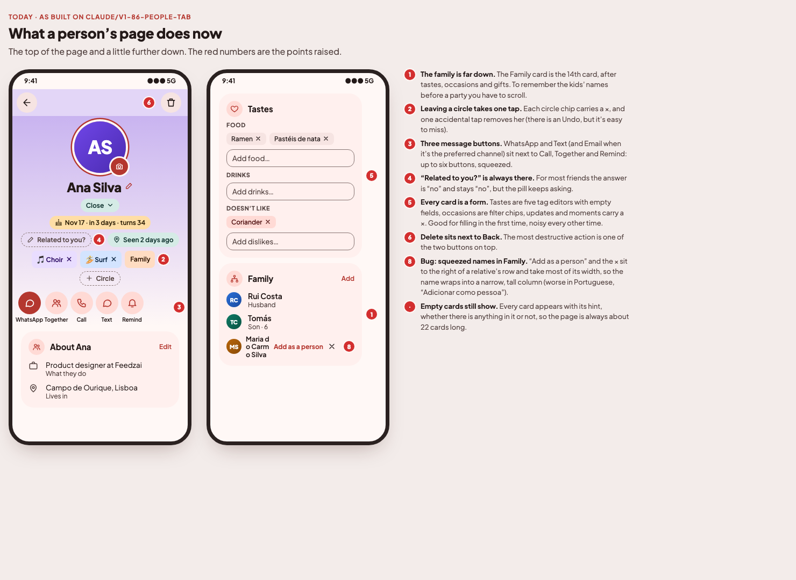
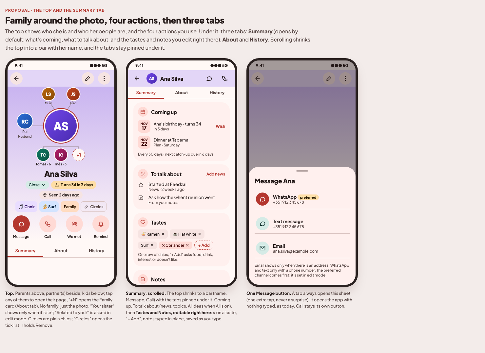
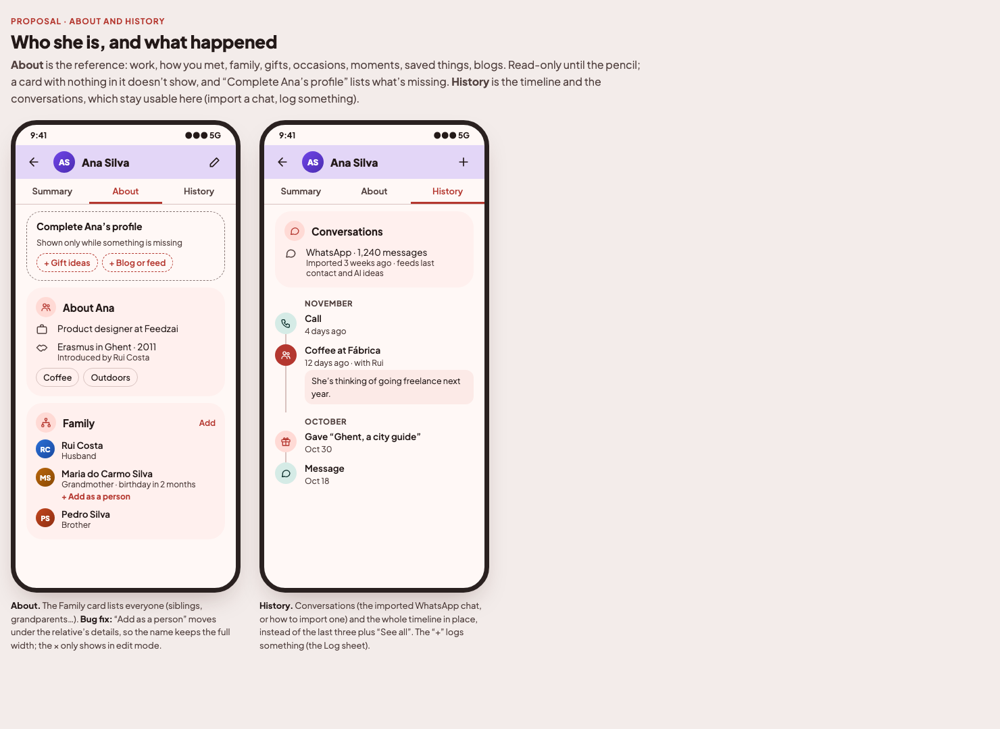
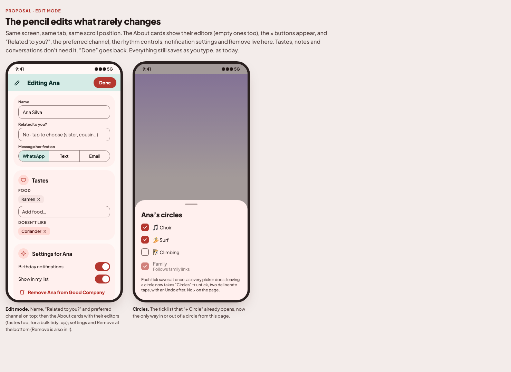

# Person page: issue plan (2026-11-14)

Owner review of a person's page (`FriendDetailScreen`) after the People tab review (#86). Mockups:
[`docs/mockups/v1-person/`](../mockups/v1-person/index.html). Decisions dated 2026-11-14 in
[`PRODUCT_BRIEF.md`](../PRODUCT_BRIEF.md) ("Person page · view and edit", "· family around the photo",
"· three tabs", "· one Message button", "· circles and \"Related to you?\""). Base: `origin/main` @ `584bc1b` (#86 merged).

## Owner answers (2026-11-14)

1. **Edit on the same screen**: the pencil switches the page to edit mode, not a separate screen.
2. **Family around the photo, as a small network**: parents above, partner(s) beside, kids below. Siblings stay in the
   Family card.
3. **Message always opens the sheet** (no "tap goes straight to the preferred app").
4. **"Related to you?" only in edit mode**; the page shows the relation only when it is set.
5. **Tastes, notes and conversations stay editable on the page** (everyday use), not behind the pencil.
6. **Three tabs** under the top: Summary · About · History.
7. **Bug:** in the Family card a relative's name is squeezed into a narrow, tall column when "Add as a person" shows.

---

## P1 · Person page: view and edit, family around the photo, one Message button

### What's wrong today
1. The family is the 14th card; the kids' names need a scroll.
2. Each circle chip has a ×: one stray tap takes the person out of the circle.
3. WhatsApp, Text (and Email when preferred) are separate buttons next to Together, Call and Remind: up to six.
4. "Related to you?" always shows, for friends who are not family too.
5. Every card is a form (five tag editors with empty fields, occasion chips, × on updates and moments), good for the
   first fill, noisy every day after.
6. Delete sits in the top bar next to Back.
7. Every card shows with its hint even when empty, so the page is always about 22 cards long.
8. **Bug:** `RelativeRow` (`ProfileCards.kt`) puts the "Add as a person" `TextButton` and the × in `ListItem`'s
   trailing slot; they take most of the width and the name wraps into a narrow column (worse in PT/FR/RO).

### What to build: view mode (`feature/friends`, `core:ui`)
- **Top bar:** Back · pencil (edit mode) · ⋮ (Remove). Delete leaves the top bar.
- **Family network around the photo** (new `core:ui` component, e.g. `FamilyRing`; pure layout, no graph library):
  parents (`PARENT`, `STEP_PARENT`) above, partners (`LinkCategory.ROMANTIC`, current only) beside, kids (`CHILD`,
  `STEP_CHILD`, plus legacy `Friend.kids` relatives not yet people) below the name, up to four, then "+N", which
  scrolls to the Family card. Sizes: photo 112dp, partner 48dp, parents and kids 40dp, first name (kids: "· age")
  under each. Tapping a person opens their page; a relative who isn't a person opens the Family card. No family →
  just the photo, as today. Read the other side of each link with `LinkType.inverse` (gotcha 30). Accessibility:
  each avatar announces "<name>, <relation>".
- **Under the name:** closeness pill (opens the picker, as #86), birthday pill, "Seen …" pill, the relation to me only
  when set ("Your sister"). No "Related to you?" pill.
- **Circles:** chips without ×; tap opens the circle; a "Circles" chip (pencil icon) opens the existing tick sheet
  (`CircleSheet`), which keeps saving on each tick with Undo (decision "Pickers · save without a Save button").
- **Four actions:** **Message** · Call · We met · Remind. Message opens a sheet listing WhatsApp and Text (when there
  is a phone number) and Email (when there is an address), preferred first with a "preferred" badge; each opens the
  app with nothing typed (`wa.me`, `sms:`, `mailto:`, as today). Message is disabled with neither number nor address;
  Call without a number. The emphasised action is Message when a messaging channel is preferred, Call when Call is.
- **Three tabs** under the top (`PrimaryTabRow`; one `LazyColumn` per tab or one list switching its items, whichever
  keeps the collapsing top simple). Scrolling collapses the top into a bar (back, small avatar, name, Message, Call);
  the tabs stay pinned under it. The chosen tab survives rotation (`rememberSaveable`), not app restarts; the page
  always opens on Summary. A `+N` tap or a "Complete" chip switches tab and scrolls to the card.
  - **Summary** (default): Coming up (birthday banner, plans, upcoming moments, the catch-up rhythm line from Stay in
    touch, "I called" / snooze actions) → To talk about (news with "Add news", topics from notes, AI ideas when AI is
    on, gotcha 33) → **Tastes, editable** (one row of chips with ×, dislikes in the error-container colour, "+ Add"
    asks food / drink / interest / doesn't like; the existing tag catalogue) → **Notes, editable** in place.
  - **About**: "Complete <name>'s profile" → About (work, place, how you met, occasions as plain chips, "More about"
    fields) → Family and other links → Moments (all, not only upcoming) → Gifts → Saved → Feeds.
  - **History**: Conversations (the imported WhatsApp chat count, or how to import one) → the whole timeline in place
    (no "See all"), "+" in the collapsed bar opens the Log sheet.
- **Empty cards don't show** in About. "Complete <name>'s profile" lists a chip per empty section ("+ Gift ideas",
  "+ Blog or feed"…); a chip opens that section's add sheet. It goes when nothing is missing. Summary's cards hide
  when empty too, except Tastes and Notes, which are always there to type into.
- **Family card bug:** "Add as a person" moves out of the trailing slot to a small text button under the relative's
  details, so the name keeps the full width; the × shows only in edit mode.
- Kinship proposals (`KinshipCard`) stay right under the top, as today.

### What to build: edit mode
- The pencil flips `editing` in `FriendDetailContent` (screen state, `rememberSaveable`; nothing stored). Same tab,
  same scroll position; the top bar becomes "Editing <name>" · **Done**. Back while editing leaves edit mode first.
- On top: name, **"Related to you?"** (the existing "is your…" sheet), preferred channel.
- The About cards show, empty or not, with today's editors: occasion chips, × on moments, relatives and links,
  "About" fields, "More about" fields; the Stay in touch rhythm controls (closeness rhythm, custom "every N days").
  Tastes keep their per-group tag editors here too, for a bulk tidy-up. Notes and conversations don't change.
- At the bottom: the Settings card (birthday notifications, show in my list, the others in `prefs`) and **Remove
  <name>** (same confirm dialog as today).
- Everything still saves as you type or choose; no Save button (decision "Pickers · save without a Save button").

### Not changing
- Data: nothing is stored differently; no migration, no backup change.
- The Story CTA, birthday wish, We met panel, Log sheet, plan editor and reminder editor behave as today.

### Tests
- ViewModel or a pure helper (`FamilyRing` input, e.g. `familyAround(friend, links)`): parents/partners/kids split,
  ex-partners excluded, step-family placed, legacy relatives included, "+N" after four kids.
- Pure helper for the empty-section list behind "Complete <name>'s profile" (which sections are empty, card hidden when
  none are), and which tab each card belongs to.
- Message sheet options: phone only, email only, both, neither; preferred first.
- `AppModuleTest` unchanged unless a new ViewModel appears.
- Strings in all five languages (`add-strings`): Message, the sheet title, the three tab names, "Editing <name>",
  "Done", "Complete <name>'s profile", "Circles", "+ Add" for tastes and its kind picker, the Family avatar
  descriptions. Remove strings nothing uses any more.
- Screenshots refreshed (`capture-screenshots`): `friend.png`, `friend-dark.png`, `friend-es.png`.

### Done when
A person's page opens to their family around the photo, four actions with one Message sheet and three tabs (Summary
first, with tastes and notes editable); About shows only the cards that have something in them; a circle, relative or
moment can't be removed by one stray tap; the pencil shows the remaining editors on the same screen; relatives' names in
the Family card use the full width.

**Skills to load:** `area-people` (links, kids, relation to me), `add-strings`, `capture-screenshots`, `new-screen` is
not needed (no new route).
